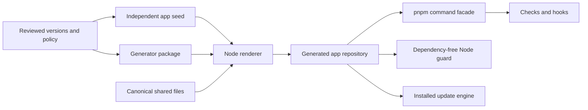
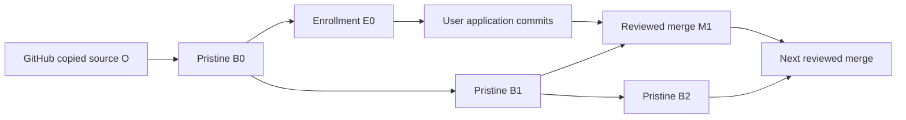
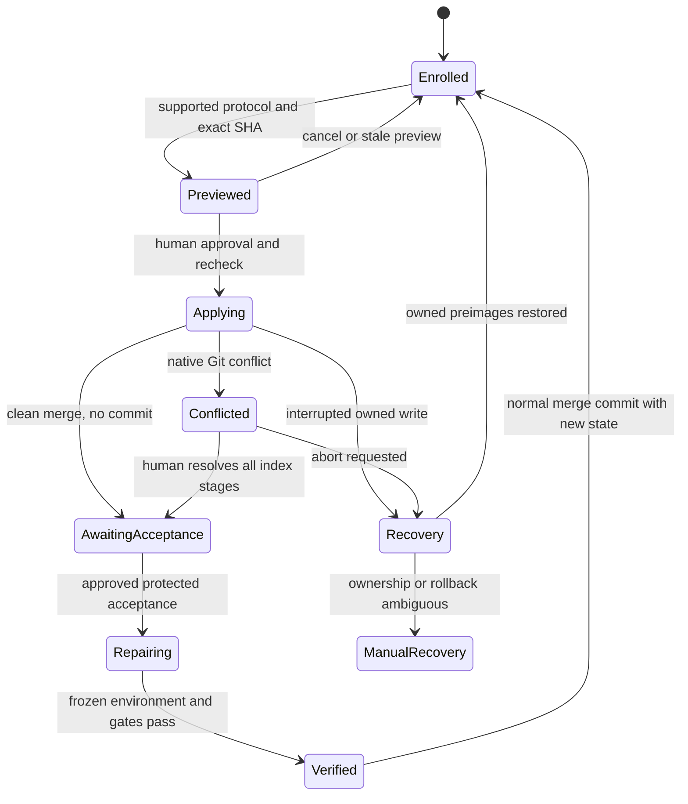
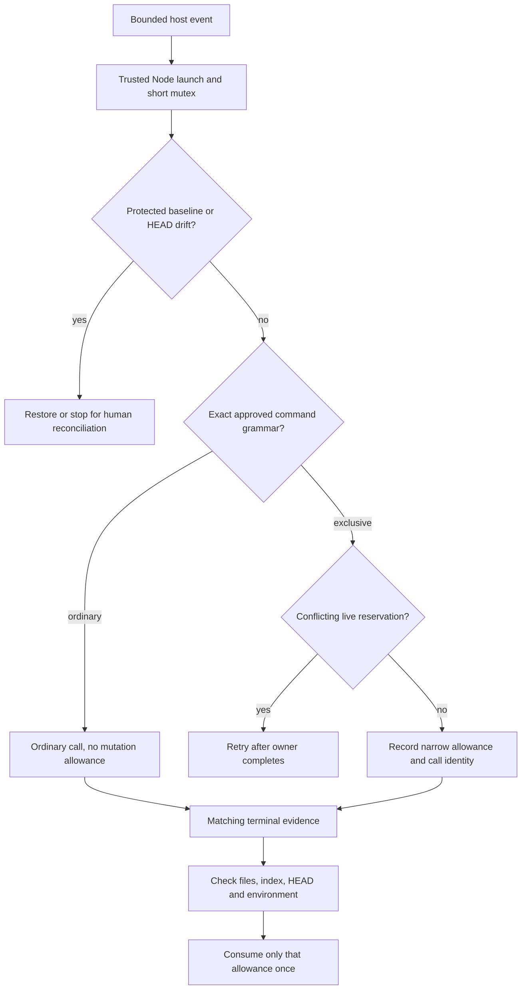

# JavaScript-Only Next.js Development Template - Plan

## Goal Capsule

**Objective:** Geliştiriciler, uygulamaya özel kararlar vermeden yeni bir Next.js projesi başlatabilsin; aynı geliştirme kurallarıyla çalışabilsin ve template güncellemelerini kendi değişikliklerini koruyarak alabilsin.

**Means:** Node tabanlı generator, bağımsız Next.js uygulama çıktısı ve Git üzerinden üç yönlü template güncellemesi; KTD1–KTD4.

**Authority:** Kullanıcının son JS/TypeScript-only talebi önce gelir. Product Contract davranışları, Planning Contract teknik mekanizmaları belirler. Bir uygulama birimi bu sözleşmeleri değiştiremez. Python template davranış kaynağıdır; yeni projenin çalıştırma bağımlılığı değildir.

**Execution:** Bu belge kod implementasyonu içindir. Mevcut checkout yalnız plan ve Compound Engineering başlangıç ayarlarını içerir. Generator, uygulama, hook ve guard henüz uygulanmış veya test edilmiş değildir. U1–U16 tamamlanmadan template kullanıma hazır sayılmaz.

**Ownership and shipping:** Implementer feature branch üzerinde çalışır; kullanıcı yayınlama ve korunan politika değişikliklerinin onay sahibidir. R27–R29 yayınlama sınırını belirler. Bu plan push, PR, merge, release veya deploy izni vermez.

**Stop conditions:** Doğrulanmamış baseline/provenance, kullanıcının dosyalarıyla çakışan kurulum, korunan dosyalarda onaysız değişiklik, çözümlenmemiş merge conflict, desteklenmeyen renderer protokolü veya uyumsuz dependency seti ilgili işlemi durdurur. Kontrol azaltmak tamamlanma yöntemi değildir.

## Product Contract

### Summary

`justmumu/nextjs-dev-template`, genel amaçlı bir Next.js geliştirme template’i olacak. Generator, guard, testler, dokümantasyon, hook ve release araçları JS/TypeScript ekosisteminde çalışacak. Üretilen uygulama kendi dependency graph’ına, sürümüne ve Git geçmişine sahip olacak. Template bakımındaki iyileştirmeler, uygulama değişiklikleri korunarak alınabilecek.

### Problem Frame

Referans Python repo yalnız boş bir uygulama sunmuyor: tekrar üretilebilir kurulum, ortak komutlar, sıkı kontroller, ajan izinleri, güncelleme ve yayınlama kuralları sağlıyor. Bunların yalnız dosya adlarını değiştirerek taşınması yeterli değil. Next.js’in ürettiği dosyalar, pnpm’in script davranışı, server/client ayrımı ve Git üzerinden template güncellemesi ayrı kararlar gerektiriyor.

### Key Decisions

- D1. Proje ve bütün geliştirme araçları JS/TypeScript ekosisteminde olacak. Governs R1–R2. (session-settled: user-directed — chosen over Python/Copier/uv altyapısını korumak: kullanıcı yeni projede yalnız JS ekosistemini istedi.)
- D2. Başlangıç uygulaması business logic taşımayacak. Governs R3–R4. (session-settled: user-directed — chosen over SaaS/auth/veritabanı starter’ı: mevcut template gibi genel amaçlı geliştirme temeli isteniyor.)
- D3. Ayrı repository kullanılacak; Python template multi-stack generator’a dönüştürülmeyecek. Governs R5–R9. (session-settled: user-approved — chosen over mevcut repoya ikinci stack eklemek: bağımsız bakım ve güncelleme sınırı korunuyor.)
- D4. Kaynak reponun kalite ve onay davranışları korunacak. Governs R10–R21, R27–R29. (session-settled: user-approved — chosen over yalnız create-next-app çıktısını paketlemek: kabul edilen öneriler geliştirme disiplinini de kapsıyor.)
- D5. Compound Engineering ayarları aynı olacak; gerçek e-posta commit metadata’sına girmeyecek. Governs R22, R30. (session-settled: user-directed — chosen over farklı ajan ayarları ve varsayılan Git kimliği: kullanıcı bu iki koşulu açıkça belirtti.)

### Requirements

#### Ecosystem and application

- R1. Generator ve üretilen proje Node/pnpm ile kurulup geliştirilebilmeli; Python, uv, Copier, MkDocs, Python pre-commit/Commitizen veya Make gerektirmemeli.
- R2. Guard ve kurulum/kurtarma girişleri `node_modules` olmadan çalışmalı; proje bağımlılıklarının bozulması korumayı devre dışı bırakmamalı.
- R3. Uygulama Next.js App Router, TypeScript ve minimal CSS ile başlamalı; auth, veritabanı, ödeme, state framework’ü veya ürün akışı içermemeli.
- R4. Başlangıç ekranları semantik HTML, klavye erişimi, görünür focus, temel metadata, not-found ve hata sınırı sağlamalı; build uygulamaya ait dış servis veya secret istememeli.

#### Generation and updates

- R5. Generator ile üretilen uygulamanın dosya, dependency ve sürüm sahipliği ayrı olmalı.
- R6. Aynı kaynak revision ve cevaplar aynı üretilen dosyaları ve modları vermeli; kişiselleştirme kod çalıştırmamalı veya `latest` çözümlememeli.
- R7. Yerel oluşturma ve GitHub template oluşturma eşdeğer uygulama sözleşmesini sağlamalı; başarısız kurulum kullanıcı verisini kaybetmemeli.
- R8. Güncelleme bağımsız kullanıcı düzenlemelerini, özel dosyaları, dependency eklemelerini ve uygulama sürümünü korumalı; gerçek conflict’leri görünür bırakmalı.
- R9. Tam bir fresh clone sonrasında en az iki ardışık güncelleme çalışmalı; eski geçici checkout veya yalnız yerel ref’lere bağımlı olmamalı.

#### Commands and quality

- R10. Rutin geliştirme tek bir korunan komut arayüzü üzerinden yürümeli; hook, CI ve dokümantasyon farklı kontrol bayrakları üretmemeli.
- R11. Kurulum reviewed lock’tan yapılmalı; dependency değişikliği başka script, runtime veya politika değişikliklerine izin vermemeli.
- R12. Formatting, lint, strict typing, lock tutarlılığı ve unit testleri zorunlu olmalı; suppression kuralı gerekçe ve dar kapsam istemeli.
- R13. App ve altyapı unit kapsamları ayrı ölçülmeli; import edilmemiş uygun kaynak dosyaları coverage hesabına girmeli.
- R14. Test türü süresine göre değil gerçek bileşen etkileşimine göre belirlenmeli; async RSC ve üretim çalışma davranışı gerçek build/browser testleriyle doğrulanmalı.
- R15. Commit hook’u değişen dosyaları kontrol etmeli; pre-push rutin check ve docs kapılarını çalıştırmalı. Geçen hook kapıları gereksiz yere tekrar edilmemeli.

#### Agent policy and recovery

- R16. Korunan yapılandırmalar, onları çalıştıran helper’lar ve ayarları gölgeleyen dosyalar ortak politika kapsamına girmeli.
- R17. Guard onaysız protected worktree/index değişikliklerini düzeltmeli; onaysız HEAD değişikliğini ve çağrı dışı drift’i görünür biçimde durdurmalı.
- R18. Call completion, session/turn/call kimliğiyle eşleşmeli; yielded çıktı, süre geçmesi veya yinelenen callback onay yerine geçmemeli.
- R19. Uzun çalışan dev server korunan dosya değiştirme izni vermemeli; exclusive işlemler çakışmamalı ve worktree durumları ayrılmalı.
- R20. Codex doğrudan korunan dosya editi yapamamalı; kullanıcı exact diff’i uygulamalı. Claude’un kullanıcı onaylı protected Edit/Write yolu ayrıca korunmalı.
- R21. Guard bir OS sandbox veya tam dependency bütünlüğü garantisi olarak sunulmamalı; kurtarma başarısızken durum temiz kabul edilmemeli.
- R22. Claude Code ve Codex ortak `AGENTS.md` politikasını kullanmalı; CE ayarları kaynakla aynı kalmalı ve core geliştirme plugin olmadan çalışmalı.

#### Verification, documentation and delivery

- R23. Dokümantasyon build’i bozuk iç sayfa, asset ve anchor bağlantılarında başarısız olmalı; private çalışma notları public dokümana girmemeli.
- R24. CI production build, browser, altyapı ve generator davranışlarını doğrulamalı; aynı statik kontrolü bütün matris hücrelerinde tekrar etmemeli.
- R25. Fork PR’ları secret veya elevated write token almamalı; Actions immutable SHA ile pinlenmeli ve dependency güncellemeleri review görmeli.
- R26. Normal production çalışma yolu ve kaynak checkout’tan bağımsız standalone artifact senaryosu doğrulanmalı; deployment scaffold zorunlu olmamalı.
- R27. Geliştirme feature branch ve PR üzerinden yürümeli; Conventional Commit subject sınırı 72 karakter ve merge yöntemi normal merge commit olmalı.
- R28. Sürüm bump’ı tag üretmeden review’a gitmeli; annotated release tag yalnız doğrulanmış güncel main merge commit’ine uygulanmalı.
- R29. Her push, PR açma, merge, bump, release tag ve deploy için ayrı kullanıcı onayı gerekli olmalı; önceki onay yeni işlemleri kapsamaz.
- R30. Bu repo commit’lerinde author ve committer GitHub noreply kullanmalı; üretilen projelere template sahibinin Git kimliği yazılmamalı.

### Actors and Flows

| ID | Aktör / akış | Sözleşme |
| --- | --- | --- |
| A1 | Template bakımcısı | Generator ve seed’i değiştirir; R5, R24, R27–R29 |
| A2 | Uygulama geliştiricisi | Proje üretir, geliştirir, günceller ve release hazırlar; R7–R15, R28 |
| A3 | Claude Code / Codex | Ortak komutları kullanır; host’a özgü onay sınırına uyar; R16–R22 |
| A4 | CI / ilk kurulum botu | Tanımlı doğrulamayı çalıştırır; yetkisi workflow ile sınırlıdır; R24–R25 |
| F1 | Yerel oluşturma | Cevap doğrulama → deterministic render → staging doğrulama → baseline/enrollment → açık setup |
| F2 | GitHub oluşturma | Copied commit + sentinel → staging → workflow parity → source/history kurulumu → tek bot push |
| F3 | Geliştirme | Kaynak değişikliği → focused feedback → commit hook → onaylı push + pre-push → CI |
| F4 | Dependency değişikliği | Dar komut → semantic diff → frozen doğrulama → izinli değişiklik veya geri alma/repair |
| F5 | Template güncelleme | Kaynak SHA → bound preview → insan apply → conflict çözümü → protected kabul → repair → check/merge commit |
| F6 | Release | Onaylı bump → review PR → regular merge → ayrı tag onayı → tag push → trusted validator |
| F7 | Kurtarma | Drift/yarım işlem tespiti → ilgili journal/diagnostic → sahipliği doğrulanmış dar recovery → tekrar doğrulama |

### Acceptance Examples

- AE1. Covers R1–R2, R6–R7: Python executable’ları olmayan desteklenen temiz ortamda iki farklı proje adıyla oluşturma, setup, check, docs ve build başarılıdır.
- AE2. Covers R8–R9: Kullanıcının component’i, ek dependency’si ve `2.4.1` uygulama sürümü ordinary full clone sonrası iki template güncellemesinde korunur.
- AE3. Covers R8, R17, R20: Kullanıcı ile template aynı config satırını değiştirince gerçek Git conflict’i oluşur; Codex bunu otomatik kabul edemez.
- AE4. Covers R11, R16: İzinli package ekleme sırasında lifecycle script `scripts.check` değerini değiştirirse politika değişikliği restore edilir; kurulum bozulduysa repair gerekir.
- AE5. Covers R2, R18: `node_modules` yokken guard çağrı kimliğini doğrular; geç gelen başka çağrı sonucu mevcut değişikliği onaylayamaz.
- AE6. Covers R12–R14: Yeni fakat import edilmemiş uygun app modülü coverage denominator’ına girer; yanlış server-only import üretim build’ini düşürür.
- AE7. Covers R23: Var olan bir dokümandaki olmayan `#anchor`, public docs gate’ini nonzero exit ile düşürür.
- AE8. Covers R28–R30: Hook’u başarısız bump tag üretmez; feature branch üzerinde release tag reddedilir; yayın öncesi author/committer noreply doğrulanır.

### Scope Boundaries

V1: tek Next.js app, tek generator package, Linux/macOS/WSL yerel dosya sistemi, Node 24, pnpm, Git; JS tabanlı altyapının tamamı ve gerçek güncelleme testi.

Non-goals: business logic, auth/ORM/veritabanı seçimi, Tailwind/UI kit, global state kütüphanesi, i18n framework’ü, Docker/Kubernetes/cloud deployment scaffold, npm package publishing, monorepo orchestrator, otomatik merge veya release, native Windows/NFS garantisi, OS sandbox, keyfi mevcut repoyu otomatik template’e dönüştürme.

### Deferred to Follow-Up Work

Ek Node major’ları, native Windows, farklı deployment profilleri, template cevaplarını sonradan yeniden adlandırma/migration ve ayrı paylaşılan politika paketi ancak gerçek ihtiyaç ve test kapsamı oluşunca değerlendirilecek. Bunlar V1 tamamlanmasının yerine geçmez.

### Open Questions

Kullanıcıya dönmeyi gerektiren ürün sorusu yok. U1 exact sürümleri ve native prebuilt uyumluluğunu doğrulayacak. Uyumsuzluk bulunursa ilgili dependency seçimi düzeltilir; R1 veya kalite kapıları gevşetilmez. Başlangıç remote’un yayınlanması R29 kapsamında daha sonra onaylanır.

## Planning Contract

### Key Technical Decisions

#### Repository and toolchain

- KTD1. Tek private Node generator package’ı ve workspace üyesi olmayan bağımsız app seed’i kullanılacak. Root `package.json`/lock generator’a, seed manifest/lock uygulamaya aittir. Generated repo ayrı graph’tır; `workspace:*`, parent override veya generator `node_modules` çözümlemesine dayanmaz. Implements R1, R5. (session-settled: user-directed — chosen over Python/Copier araç zinciri: son kullanıcı talebi bütün ekosistemi JS/TS olarak belirledi.)
- KTD2. Node 24 ve Next.js 16 App Router temel alınacak; pnpm 12’nin kullanılan özellikleri içeren exact sürümü seçilecek. U1 Node/Next/React/TypeScript/ESLint/Vitest/Playwright peer/engine uyumunu gerçek fixture ile kanıtlar. Exact pinler, `.node-version`, `packageManager` ve lock reviewed veri olarak saklanır. `devEngines.runtime` ile CI runtime’ını gizlice değiştiren ikinci runtime seçici kullanılmaz. R1, R11. [Next support](https://nextjs.org/support-policy), [Node releases](https://nodejs.org/en/about/previous-releases), [pnpm package metadata](https://pnpm.io/package_json).
- KTD3. Generator dependency-free checked JS renderer kullanacak; template dosyaları ve canonical shared dosyalar açık manifest ile kopyalanacak. Kişiselleştirme yalnız ilan edilmiş metadata projeksiyonlarında yapılır; JSON, JSON serializer ile yazılır. Genel metin replace, `eval`, Jinja veya script çalıştıran cevaplar yoktur. R6. giget/degit indirme sağlar; güncelleme garantisi sağlamış sayılmaz. [giget](https://github.com/unjs/giget), [degit](https://github.com/Rich-Harris/degit).
- KTD4. Güncelleme pristine rendered snapshot Git lineage’ı üzerinden native three-way merge kullanacak. `.template-state.json` baseline commit/tree, source full SHA, answer digest ve protokol sürümlerini tutar; kendi hash’ine gönderme oluşmaması için pristine tree dışında kalır. Projen’in managed-file modeli yerine normal dosya düzenlemeleri korunur. R8–R9. [Git merge](https://git-scm.com/docs/git-merge), [projen workflow](https://projen.io/docs/introduction/the-projen-workflow/).
- KTD5. Canonical app seed lock reviewed dependency graph’tan üretilir. Render yalnız name/description/owner gibi frozen uyumu test edilmiş metadata’yı kişiselleştirir; setup relock yapmaz. Ortak tool sürümleri `tooling/versions.json` üzerinden projekte edilir; root ve seed lock’ları birleştirilmez. pnpm 12 lock’u birden fazla YAML document içerebilir; elle varsayımsal parser yazılmaz. R5–R6, R11. [pnpm install](https://pnpm.io/cli/install), [pnpm package metadata](https://pnpm.io/package_json).
- KTD6. Kaynak Python reponun `7f8da69c6f9f69e4fc4d1547c712fb8ef1f1d0b7` revision’ı davranış referansı olacak. `tooling/upstream-policy.json` source revision, alınan davranışlar ve uyarlama eşlemelerini kaydeder. JS kodu ve testleri bu repoda canonical’dır; gelecekteki kaynak değişiklikleri otomatik executable import edilmez. Ayrı platform reposu oluşturulmaz. R16–R22.

#### Command and quality model

- KTD7. Rutin arayüz `pnpm run <script>` olacak; script’ler korunan Node dispatcher’larına gider. Setup/repair/admin istisnaları aşağıdaki Command Contract’ta tek tek tanımlıdır. pnpm `verifyDepsBeforeRun: error` korunur; bozuk kurulumdan çıkmak için bu ayar kapatılmaz. `enablePrePostScripts: false` ile gizli pre/post zincirleri önlenir. R2, R10. [pnpm run](https://pnpm.io/cli/run), [pnpm build settings](https://pnpm.io/settings/build).
- KTD8. ESLint flat config + Next kuralları + `strictTypeChecked`, formatting için yalnız Prettier kullanılacak. TS `strict`, `noUncheckedIndexedAccess`, `exactOptionalPropertyTypes`, `noImplicitOverride`; uygun projelerde `checkJs` açıktır. `next typegen` temiz checkout’taki `tsc --noEmit` öncesinde çalışır. Next build lint yerine sayılmaz. R12. [typed linting](https://typescript-eslint.io/getting-started/typed-linting/), [strict presets](https://typescript-eslint.io/users/configs/), [Next CLI](https://nextjs.org/docs/app/api-reference/cli/next).
- KTD9. Suppression yalnız belirtilen rule/next-line için, somut gerekçeyle kabul edilir; unused ESLint disable error’dır. `@ts-ignore`, broad `eslint-disable`, test-only fake coverage, `ignoreBuildErrors` ve check’i düşüren alternatif config yoktur. İstisna gerekirse korunan policy diff olarak review edilir. Formatter/linter fix’leri kayıtlı araçların dar dosya kapsamıyla sınırlıdır; Ruff safe-fix semantiği ESLint’e varsayılmaz. R12–R13. [ESLint suppression](https://eslint.org/docs/latest/use/configure/rules).
- KTD10. Vitest’in Node altyapı ve jsdom app projeleri ayrılacak; gerçek process/Git/filesystem/build etkileşimleri ayrı integration projesinde kalacak. Guard runtime bağımsızlığı, dış harness’ın başlattığı boş fixture’daki raw Node process ile kanıtlanır; ikinci unit runner eklenmez. Async RSC için Vitest doğrudan fonksiyon çağrısı yeterli sayılmaz. R13–R14. [Vitest projects](https://vitest.dev/guide/projects), [Next Vitest guide](https://nextjs.org/docs/app/guides/testing/vitest).
- KTD11. Dependency helper yalnız istenen dependency map değişikliği, lock çözümlemesi ve local install state için yetkilidir. `scripts`, `engines`, `packageManager`, overrides, workspace policy ve build/skill izinleri ayrı korunan değişikliktir. pnpm `strictDepBuilds: true`; actual package ihtiyacına göre reviewed build izinleri ve `skills.dirs: []` kullanılır. `permissions.build` gibi öncelikli alternatif alanlar da korunur. R11, R16. [pnpm build policy](https://pnpm.io/settings/build).

#### Application boundaries

- KTD12. Default Server Component, küçük ve gerekçeli client boundary kullanılacak. Core app’te gereksiz API/Server Action/env parser oluşturulmaz. Gelecekte dış girdi runtime’da doğrulanır; Server Action eklemek validation/authz yükümlülüğü doğurur. `server-only` sınırı fixture build testiyle kanıtlanır. Genel `force-dynamic`/`no-store` veya cache opt-in zorlaması yoktur. R3–R4, R14. [Server/client components](https://nextjs.org/docs/app/getting-started/server-and-client-components), [data security](https://nextjs.org/docs/app/guides/data-security).
- KTD13. `agentRules: false` ve managed marker içermeyen canonical `AGENTS.md` kullanılır. Installed Next sürümüyle eşleşen local docs yönlendirmesi elle yönetilir. `next-env.d.ts`, `.next` ve route type çıktıları ignored’dır; `tsconfig` başlangıçta eksiksizdir. `agentFeedback` ayrı özelliktir, aynı ayar gibi ele alınmaz. R16, R22. [agentRules](https://nextjs.org/docs/app/api-reference/config/next-config-js/agentRules).
- KTD14. System font ve CSS/CSS Modules kullanılacak; build font indirmeyecek. `.env.example` yalnız gerçekten tüketilen değişkenleri belgeler; başlangıçta uygulama env’i gerekmiyorsa boş açıklama yeterlidir. Public env’in build-time gömülmesi ve server runtime ayrımı docs/test sözleşmesidir. Secret değerleri log ve client artifact’larına girmez. Nonce CSP varsayılan değildir; dinamik rendering etkisi dokümante edilir. R4. [env](https://nextjs.org/docs/app/guides/environment-variables), [fonts](https://nextjs.org/docs/app/api-reference/components/font), [CSP](https://nextjs.org/docs/app/guides/content-security-policy).

#### Guard, hooks and approvals

- KTD15. Guard checked-in `.cjs` + JSDoc/checkJs olacak; yalnız `node:` modülleri ve korunan local `.cjs` dosyalarını yükleyecek. `.ts` runtime loader veya build artifact gerektirmeyecek. POSIX launcher Node başlamadan `NODE_OPTIONS`, `NODE_PATH` ve compile-cache etkilerini temizler; setup’ta bağlanan project dışı Node binary’sini kullanır. `--no-addons`, `--no-global-search-paths`, `--disable-proto=throw` uyumu U6’da doğrulanır. R2, R16, R21. [Node 24 CLI](https://nodejs.org/docs/latest-v24.x/api/cli.html).
- KTD16. Kısa state mutex ile uzun tool reservation ayrı tutulacak. Mutex exclusive creation + ownership token; state aynı dizinde temp/rename ile yazılır. Yaş tek başına reclaim sebebi değildir. Killed owner sonrası offline insan recovery’si mutex’i temizleyebilir; baseline ve pending call’ları kabul/silme yetkisi vermez. Yerel Linux/macOS/WSL dosya sistemi desteklenir; NFS/native Windows vaat edilmez. R18–R21. [Node fs flags](https://nodejs.org/docs/latest-v24.x/api/fs.html#file-system-flags).
- KTD17. Command parser, izinli mutation için yalnız dar literal grammar kabul edecek. Genel shell interpreter yazılmayacak; quoted veri, heredoc ve executed shell parçalarının kaynak regression ayrımı korunacak. Unknown/composed command onay almış bir dependency route sayılmaz. Bypass tespiti ve post-call restore guardrail’dir; keyfi kötü niyetli shell’e karşı sandbox değildir. R16–R21.
- KTD18. Üç Git hook’unu küçük Node-core installer yönetecek: pre-commit, commit-msg, pre-push. Git’in çözdüğü hook path’i kullanılır; yabancı hook overwrite edilmez, `core.hooksPath` değiştirilmez. lint-staged yalnız changed-file işini, commitlint mesaj kontrolünü yapar. Husky/simple-git-hooks’un ek skip/load/config yüzeyi alınmaz. R15, R27. [Git hooks](https://git-scm.com/docs/githooks), [lint-staged](https://github.com/lint-staged/lint-staged), [commitlint](https://github.com/conventional-changelog/commitlint).
- KTD19. Guard kodu önce fixture’da test edilir; canlı checkout hook registration/guard trust’ı U16’ya kadar etkinleştirilmez. Tam candidate policy/helper/config baseline’ı normal commit ile kaydedildikten sonra setup/retrust yapılır. Sonraki protected değişikliklerde R20 geçerlidir; plan onayı edit yetkisi üretmez. R17–R22.
- KTD20. Template preview read-only proje etkisine sahip olacak. İnsan apply’ı kendi terminalinde, ajan writer’ları durmuşken yapacak; Codex’e `template:apply` isimli broad otomatik izin eklenmeyecek. Conflict’ler çözüldükten sonra exact protected diff için `guard-accept` onayı, sonra repair ve normal commit gerekir. Dependency bozukken updater inspect/abort/resume için insanın kullanacağı core `.cjs` yolu ayrıca vardır. R8, R17, R20.

#### Documentation, production and releases

- KTD21. VitePress + pinned hyperlink, build edilmiş bütün HTML dosyalarında iç sayfa/asset/fragment doğrulaması yapacak. VitePress’in built-in dead-link kontrolü tek başına anchor garantisi değildir. `ignoreDeadLinks` kapalı kalır; checker nonzero sonucu kapıya aktarılır. R23. [VitePress config](https://vitepress.dev/reference/site-config#ignoredeadlinks), [VitePress link implementation](https://github.com/vuejs/vitepress/blob/main/src/node/markdownToVue.ts), [hyperlink](https://github.com/Munter/hyperlink).
- KTD22. Production E2E normal build/start yolunda çalışacak. Standalone doğrulaması ayrı disposable fixture’da `output: standalone` varyantını kurar; `public` ve `.next/static` ile artifact’ı checkout dışına taşır. Bu, core app’i standalone moda zorlamaz ve deployment ürünü eklemez. R14, R26. [Playwright guide](https://nextjs.org/docs/app/guides/testing/playwright), [standalone output](https://nextjs.org/docs/app/api-reference/config/next-config-js/output).
- KTD23. Release Node orchestrator + semver + conventional-changelog ile yönetilecek. Her reponun canlı sürümü kendi `package.json` alanıdır; generated app `0.0.0` başlar. Renderer başlangıç sürümünü korur, canlı release sürümünü template state’e taşımaz. Changelog enrollment sonrası gerçek app commit’lerini alır; doğrulanmış pristine snapshot lineage’ını dışarıda tutar. R5, R8, R27–R28. [conventional-changelog API](https://conventional-changelog.js.org/conventional-changelog/api/).
- KTD24. İlk plan-only remote seed’i için ayrı kullanıcı onayı istenir; boş remote’a olmayan main üzerinden PR açılmaya çalışılmaz. İlk feature-branch plan commit’i onaylı initialization işleminde main tabanını oluşturabilir; bu exception uygulama kodu yayınlamak için kullanılamaz. Remote bu sırada dolmuşsa force push yerine durulur. Sonraki bütün implementasyon değişiklikleri R27–R29’u izler.
- KTD25. CI statik kapılar, primary Linux production, macOS altyapı uyumluluğu ve Python bulunmayan ortam smoke işlerini ayrı sahiplerle çalıştıracak. Node 22 veya tam OS × Node × browser Cartesian matrix yoktur. Browser kapsamı Chromium desktop/mobile viewport ve WebKit smoke olarak ilan edilir. R24–R25; lane ayrıntıları Verification Contract’ta.

### Command Contract

Bu tablo tek public komut sözleşmesidir. Helper invocation’ları implementation detail’dır; ajanlar alternatif bayraklarla kontrol çalıştırmaz. Argümanlar shell expansion olmadan literal argv olarak doğrulanır. Script adından sonraki parametreler pnpm tarafından script’e iletilir; gereksiz npm-style `--` separator kullanılmaz.

| Komut | Scope / sonuç | Mutation ve onay |
| --- | --- | --- |
| `node scripts/bootstrap.cjs setup` | Exact Node/pnpm doğrula, frozen install, owned hook kurulumu, opsiyonel project-local CE kurulumu | İlk setup / documented setup allowance; izinli dosya listesi sınırlı |
| `node scripts/bootstrap.cjs repair` | Yalnız project-local install state’i frozen lock’tan yeniden kur | Başarıdan sonra environment drift temizlenir; global store silinmez |
| `node scripts/bootstrap.cjs guard-accept` | İncelenen protected diff’i kabul et | Her seferinde kullanıcı prompt’u; conflict veya pending reservation’ı temizlemez |
| `pnpm run check` | Lock + format check + lint + strict typing + unit/coverage | Read-only tracked state; kapsam Verification Contract’ta |
| `pnpm run format` / `pnpm run lint:fix` | İlan edilmiş format/fix kapsamı | Dar trusted formatting allowance |
| `pnpm run typecheck` | Root tools veya app route typegen + TS kontrolü | Yalnız ignored generated çıktı |
| `pnpm run test:one --test=<path> [--name=<literal>]` | İlan edilmiş suite’ten focused test | Ek runner flags yok; suite coverage yerine geçmez |
| `pnpm run test:integration [--scenario=<id>]` | İlan edilmiş gerçek etkileşim senaryoları | Isolated fixtures; CI veya ilgili harness geliştirmesi |
| `pnpm run test:permissions` | Policy testleri + mevcut Codex CLI ile gerçek execpolicy | CLI yoksa explicit unavailable; geçiş diye raporlanmaz |
| `pnpm run deps:add --package=<spec> --group=<prod\|dev>` | İstenen dependency map + lock | KTD11; scoped npm isimleri desteklenir, arbitrary URL/shell/flags kabul edilmez |
| `pnpm run deps:remove --package=<name> --group=<prod\|dev>` | İstenen dependency kaldırma | KTD11 |
| `pnpm run deps:upgrade [--package=<name>]` | Named veya explicit all-dependency upgrade | KTD11; scripts/runtime/build policy değişmez |
| `node scripts/bootstrap.cjs deps-lock` | Kullanıcı onaylı ve guard ile reconcile edilmiş manifest editinden sonra relock + frozen sync | Dependency-free giriş; KTD11 sınırları geçerli, manifest onayını genişletmez |
| `pnpm run template:seed:refresh` | Reviewed version manifest’inden isolated seed lock üret | Maintainer-only protected update; doğrudan ajan policy edit yetkisi vermez |
| `pnpm run template:create --name=<slug> --owner=<owner> --dest=<path>` | Yerel proje oluştur | Yeni/hedefi doğrulanmış directory; publish yok |
| `pnpm run template:preview --ref=<ref>` | Exact SHA’ya bağlı update preview | Aktif protected files/index/HEAD değişmez |
| `pnpm run template:apply --preview=<path>` | Bound preview’ı uygula | KTD20 kapsamında insan terminalinde |
| `node scripts/template/update.cjs inspect\|abort\|resume` | Üç ayrı insan recovery komutu | Dependency-free; otomatik ajan allowance değildir |
| `node scripts/hooks/recover-lock.cjs` | Offline mutex recovery | İnsan terminalinde, bütün ilgili sessions durmuşken; baseline/pending calls korunur |
| `pnpm run docs:build` | Site + iç link/anchor gate | Deployment yok |
| `pnpm run dev` / `pnpm run build` / `pnpm run start` | Generated app çalışma yolları | Dev exclusive config writer değildir; root generator app başlatmaz |
| `pnpm run test:e2e` / `pnpm run test:artifact` | Production browser / standalone portability | CI; isolated process sahipliği ve cleanup |
| `pnpm run release:bump patch\|minor\|major` | Üç enum seçeneğinden biri, tag’siz bump | Her invocation ayrı onay; normal hook’lu commit |
| `pnpm run release:tag` | Reviewed main annotated tag | Ayrı onay; push ve GitHub Release ayrı adımlardır |
| `pnpm run release:validate` | Commit/tag/changelog bütünlüğü | Trusted main kodu; yayınlama yapmaz |
| `pnpm run audit:dependencies` | Runtime/dev/tool dependency raporu | Schedule/manual; otomatik fix/merge yok |

`|` içeren hücreler alternatifleri gösterir; literal shell pipe komutu değildir. Bozuk manifest, `repair` ile yeni manifest üretilerek düzeltilmez. Onaylı dependency-manifest editi lock/install state’i eski bırakabileceği için relock, `pnpm run` üzerinden çağrılmaz; core `deps-lock` girişi pnpm preflight’ına takılmadan dar helper’ı çalıştırır. `verifyDepsBeforeRun: error` açık kalır. Eksik pnpm için exact sürüm kurulum yönlendirmesi verilir; bootstrap `latest`, `npx` veya `dlx` indirmez.

### Ownership and Output Structure

Yapı yön gösterir; U-ID dosya listeleri ayrıntıyı belirler. Canonical shared dosyaların iki ayrı editable kopyası tutulmaz.

```text
nextjs-dev-template/
  package.json, pnpm-lock.yaml, pnpm-workspace.yaml, .node-version
  AGENTS.md, CLAUDE.md, .claude/, .codex/
  .compound-engineering/config.yaml
  .compound-engineering/artifacts/plans/
  tooling/
    versions.json, policy.json, upstream-policy.json
    template-manifest.json
  scripts/
    bootstrap.cjs, development.cjs, dependencies.cjs, release.cjs
    docs.cjs, format.cjs, hooks/, template/
  template/app/
    package.json, pnpm-lock.yaml, next.config.ts, tsconfig.json
    src/app/, public/, tests/app/, tests/e2e/
    docs/, application-specific config
  shared/
    application policy/config projections and documentation fragments
  tests/
    unit/, integration/, fixtures/, contracts/
  docs/.vitepress/config.ts
  .github/workflows/, .github/.template-pending
  .private/                                      # ignored
```

Generated çıktı `template/app` içeriği + manifest’te tanımlanan shared scripts/policy/tests/host config/docs projeksiyonudur. Generator-only renderer source manifest’i, generator testleri ve sentinel çıktıda kalmaz. Installed updater ve onun shared regression testleri çıktıda kalır. `tooling/project-role.json` protected explicit `generator`/`application` rolünü taşır; package varlığına veya cwd tahminine göre rol seçilmez.

### High-Level Technical Design

Aşağıdaki çizimler uygulama kodu değildir; kararlar ve akış sınırları için yön gösterir. R/KTD sahipliği diyagramdan üstündür.

#### Components and dependency ownership



#### Creation protocol and transaction boundaries

```mermaid
sequenceDiagram
  participant D as Developer or template workflow
  participant G as Node generator
  participant S as Disposable staging
  participant T as Destination
  D->>G: Validated source and answers
  G->>S: Render source and frozen locks
  G->>S: Run declared validation after source trust decision
  S-->>G: Validation result and install manifest
  G->>T: Recheck paths, HEAD and owned files
  G->>T: Install source, pristine B0 and enrollment state
  G->>T: Normal enrollment commit; never disable existing hooks
  T-->>D: Clean enrolled source or retained recovery record
  D->>T: Explicit local setup and later host trust
```

Stage `.next`, `node_modules`, browser binaries, `.git`, hook paths ve test reports source-install manifest’ine girmez. Staging doğrulaması geliştiricinin bilgisayarına bağımlılık kurulmuş olduğu anlamına gelmez.

#### Baseline data and update ancestry



Yerel create’te O yoktur; B0 ilk pristine commit’tir. State E0/M1/M2 tarafından sahiplenilir, B0/B1/B2 tree’lerinde bulunmaz. Tam clone bu ataları taşır. Pending snapshot geçici ref ile recovery süresince korunur; tamamlanınca application merge ancestry’si yeterlidir.

#### Update state machine



`baselineCommit` yeni committed gerçekliği ancak merge commit tamamlandığında temsil eder. Journal yeni/eskisini ayrı tutar. Native merge `no-ff`, `no-commit`, `no-overwrite-ignore` davranışıyla yürür; automatic stash ve blanket ours/theirs resolution yoktur.

#### Guard admission and completion



#### Modes and permissions

| Mod | Active source değişikliği | Baseline etkisi | Completion kanıtı |
| --- | --- | --- | --- |
| Pure render / preview | Yok; staging/output hedefi ayrı | Yok | Render digest / preview sonucu |
| Ordinary agent edit | Unprotected source/tests/docs | Yok | İlgili host call |
| Dependency route | KTD11’in izinli alanları | Dar diff kabulü | Exact call + post-state |
| Dev server | Ignored runtime çıktıları | Yok | Server lifecycle; mutation allowance yok |
| Human template apply | Reviewed merge ve state | Önce pending, sonra explicit kabul | Journal + Git stages + kullanıcı kararı |
| `guard-accept` | Kaynak değiştirmez | İncelenen protected diff | Kullanıcı onayı; reservation temizlemez |
| Offline mutex recovery | Kaynak değiştirmez | Değişmez | İnsan operasyonu, owner/state doğrulaması |

### Protected Policy Inventory

`tooling/policy.json` canonical inventory ve command grammar sahibidir. Host declarations ve test expectations aynı veriden türetilir veya parity testiyle kontrol edilir.

- Manifest/lock/runtime: root package, pnpm lock/workspace, committed nonsecret `.npmrc`, `.node-version`, role/version/policy/source-state metadata.
- Check definitions: TS configs ve referenced base’ler, Next/ESLint/Prettier/Vitest/Playwright/lint-staged/commitlint config’leri; helper entrypoint ve policy-bearing setup dosyaları.
- Agent state: AGENTS/CLAUDE, `.claude/settings.json`, `.codex/`, launcher/guard/completion/recovery kodu, hook installer.
- Generator authority: `tooling/template-manifest.json`, canonical shared tooling ve seed’deki policy/config girdileri. Root guard korunurken emitted policy’nin serbestçe zayıflatılması mümkün olmamalı.
- Forbidden overrides: canonical olmayan tool config dosyaları, farklı package-manager lock’ları, pnpm hook dosyaları ve nested configuration shadow’ları. Meşru fixture/managed cache trees açık scope ile ayrılır; bütün nested `package.json` dosyaları körlemesine yasaklanmaz.

`.next`, `next-env.d.ts`, coverage, browser reports ve installed packages immutable policy değildir. Dependency fingerprint yalnız `.bin` entry/link metadata’sı, top-level link topology ve pinned pnpm install metadata’sını sınırlı tarar; bütün package içeriklerini veya global store’u hash’lediğini iddia etmez. Workflow değişiklikleri review/CI sahibindedir; guard’ın kapsamı dışında kalan dosyalar dokümanda açıkça listelenir.

### Risks and Decisions

| Risk | Karar / doğrulama sahibi |
| --- | --- |
| Yeni updater, Copier’dan hazır alınan davranışları yeniden sahipleniyor | U11–U13 gerçek Git conflict/fresh-clone/recovery matrisi bitmeden release yok |
| Python guard’ın stdlib lexer/locking davranışı Node’da hazır değil | U6 literal grammar, U7 fixture parity ve ayrı mutex; sessiz basitleştirme yok |
| Guard aktivasyonu geliştirmeyi kendi içinde kilitleyebilir | KTD19; fixture testleri erken, canlı activation U16 |
| pnpm run bozuk metadata/deps yüzünden recovery’yi açamaz | Core bootstrap ve human core updater entrypoint’leri; config bypass yok |
| Yeni upstream code’u preview sırasında çalıştırmak trust sınırını aşar | Installed engine yalnız declarative manifest’i işler; executable validation ayrıca açık trust kararından sonra |
| Engine protocol değişikliği update’i döngüye sokabilir | Human-reviewed protected engine upgrade, sonra yeni preview; remote renderer otomatik çalıştırılmaz |
| Native dependency source-build Python isteyebilir | U1 declared platform prebuilt doğrulaması; Python’suz acceptance lane |
| Doküman link checker warning’i başarı sanılabilir | U8 gerçek bad-anchor nonzero fixture; her emitted HTML giriş noktası kontrol edilir |
| Aynı global pnpm store başka worktree’yi etkileyebilir | R21’in sınırlı garanti açıklaması; yalnız local repair, global store otomatik silinmez |
| CI maliyeti matrisle büyüyebilir | KTD25 ve Verification Contract’ta tek gate sahipliği |
| GitHub bot push sonraki CI’ı tetiklemeyebilir | U15 ilk kurulum workflow’u kendi production doğrulamasını tamamlar |

### Assumptions

Kullanıcı Git ve desteklenen Node/pnpm kurulumuna sahip olacak veya documented prerequisite adımlarını uygulayacak. Registry/browser binary kurulumu network gerektirebilir; bu, app build’inin font/servis/secret gerektirmemesiyle karıştırılmaz. GitHub template kaynağı kullanıcı tarafından seçilen trusted source’dur; pinned SHA tek başına executable içeriğe onay değildir.

## Implementation Units

| Unit | İş | Ana dosyalar | Depends on |
| --- | --- | --- | --- |
| U1 | Toolchain ve sahiplik baseline’ı | manifests, `tooling/` | — |
| U2 | Deterministic renderer ve seed | `scripts/template/`, `template/app/` | U1 |
| U3 | Komut ve dependency arayüzü | bootstrap/development/dependencies | U1–U2 |
| U4 | Minimal app ve strict kontroller | app/config/format | U2–U3 |
| U5 | Unit suite ve coverage | Vitest, unit/app tests | U3–U4 |
| U6 | Node guard ve semantic policy | hooks guard/policy/state | U3–U5 |
| U7 | Completion, concurrency, recovery | hooks completion/mutex | U6 |
| U8 | JS docs ve strict link gate | VitePress/docs helper | U3–U5 |
| U9 | Git hooks ve host parity | hook installer, agent config | U6–U8 |
| U10 | Production/browser/artifact proof | Playwright/integration | U4–U5 |
| U11 | Transactional create/enrollment | template create/bootstrap | U2–U3, U8–U10 |
| U12 | Update lineage ve preview | template update/state | U6–U7, U11 |
| U13 | Human apply ve update recovery | update journal/recovery | U9, U12 |
| U14 | Node release state machine | release/changelog/docs version | U9, U11–U13 |
| U15 | CI ve GitHub template workflow | `.github/`, workflow contracts | U10–U14 |
| U16 | Adoption docs ve canlı activation | AGENTS/docs/host activation | U1–U15 |

### U1. Toolchain and repository ownership

**Goal:** JS-only altyapının sürüm, dosya ve graph sınırını kurmak.

**Requirements:** R1, R5, R11, R22, R30; KTD1–KTD2, KTD5–KTD6; AE1.

**Dependencies:** Yok. Mevcut planning-only dosyaları başlangıçtır; kaynak Python repo değiştirilmez.

**Files:** `package.json`, `pnpm-lock.yaml`, `pnpm-workspace.yaml`, `.node-version`, `.gitignore`, `tooling/{versions,policy,project-role,upstream-policy}.json`, `docs/contributing/toolchain.md`, `tests/contracts/toolchain.test.ts`, `tests/integration/no-python.test.ts`.

**Approach:** Exact dependency setini official engine/peer metadata ve disposable fixture ile seç. Generator’ı private package olarak tanımla; shared tool pins için canonical veri kur. Template seed’i workspace kapsamına alma. Python davranış → JS test eşlemesinin formatını tanımla. Noreply bu repo local Git ayarı olarak kalır; template verisine yazılmaz. `pnpm run`/script argv davranışını seçilen manager ile doğrula.

**Test Scenarios:**

1. Desteklenen temiz Node ortamında exact manager ile frozen install succeeds; yanlış manager/Node anlaşılır hata verir.
2. `python`, `python3`, `uv`, `make` olmadan temel toolchain başlangıcı çalışır; native paketlerin kaynak derlemesine düşmesi başarısız kabul edilir.
3. Root graph ve seed graph ayrı lock/importer üretir; seed’e `workspace:*` veya parent çözümlemesi sızmaz.
4. Commit identity kontrolü author ve committer için noreply doğrular; oluşturulan proje manifest/state’inde template sahibinin e-posta ayarı yoktur.

**Verification:** `pnpm run test:one --test=tests/contracts/toolchain.test.ts`; ilgili no-python integration senaryosu. Bu unit’in fixture kanıtı bütün ürünün tamamlandığı anlamına gelmez.

### U2. Deterministic renderer and application seed

**Goal:** Aynı girdiden aynı uygulama kaynak ağacını üretmek.

**Requirements:** R3, R5–R6; KTD3, KTD5; F1–F2.

**Dependencies:** U1.

**Files:** `tooling/template-manifest.json`, `scripts/template/{render,inputs,manifest}.cjs`, `template/app/package.json`, `template/app/pnpm-lock.yaml`, `shared/`, `tests/unit/renderer.test.ts`, `tests/contracts/rendered-output.test.ts`, `tests/fixtures/render/`.

**Approach:** Pure render API’si filesystem manifest’i ve validated answer objesini tüketir. Copy/metadata-projection türleri sınırlıdır; unknown schema/protocol fail eder. Root-only dosyalar dışarıda kalır; shared include yerine açık source mapping ve byte parity testi vardır. Seed-lock refresh isolated standalone directory’de yapılır. Render install/commit/push yapmaz; U11 bunları ayrı orchestration olarak sahiplenir.

**Test Scenarios:**

1. Aynı SHA/answers iki farklı geçici root’ta aynı byte/mode/tree digest verir.
2. Quote, backslash, Unicode ve numeric-looking ref metadata’dan kayıpsız geçer; JSON bozulmaz.
3. Absolute/traversal destination, newline name, symlink ancestor, submodule ve unknown answer reddedilir; hedef dışına dosya yazılmaz.
4. İki farklı name/owner ile çıktı frozen lock doğrulamasını geçer; timestamp/local path/log dosyası içermez.
5. Çıktıda generator source manifest’i, sentinel, Python tools veya auth/DB scaffold yoktur; gerekli updater ve shared regressions vardır.

**Verification:** Renderer focused tests; rendered-output contract. Gerçek frozen install U3/U11 integration’a bağlanır.

### U3. Command facade and dependency transactions

**Goal:** Rutin işleri ve dependency değişikliklerini tek, dar arayüze bağlamak.

**Requirements:** R2, R10–R12; KTD7, KTD11; F3–F4.

**Dependencies:** U1–U2.

**Files:** `scripts/{bootstrap,development,dependencies,format}.cjs`, root/seed scripts projections, `tests/unit/{commands,dependency-policy}.test.ts`, `tests/integration/dependencies.test.ts`, `tests/fixtures/packages/`.

**Approach:** Command Contract’ı typed schema ile uygula; argv arrays ve shell-disabled subprocess kullan. Root/application role explicit’tir. Frozen lock gate’i active tracked/install state’i değiştirmemeli: pinned pnpm’in lock-only/frozen/offline kombinasyonunu fixture’da kanıtla; gerekli doğrulamayı disposable metadata copy’de çalıştır. `--dry-run` exit code lock gate’i değildir. İzin dışı manifest/workspace değişikliklerini preimage’a döndür; partial install state’i temiz sanma. `.npmrc` credentials external kalır ve log’a yazılmaz.

**Test Scenarios:**

1. Matching lock read-only check succeeds; stale/missing lock nonzero olur ve hiçbir tracked dosya değişmez.
2. Scoped package ve literal version selector doğru tek argv olur; duplicate/unknown flags, shell expansion ve ek script reddedilir.
3. Package add yalnız seçilen map + lock’u değiştirir; successful veya failed lifecycle script’in `scripts.check` değişikliği kabul edilmez.
4. Yeni build izin ihtiyacı anlaşılır review sonucu verir; pnpm’in workspace’e yazdığı placeholder policy otomatik benimsenmez.
5. Absent/corrupt `node_modules` pnpm run preflight’ını düşürürken core `repair` erişilebilir kalır; başarısız repair drift’i temizlemez.
6. `permissions.build`, implicit skill linking, `scriptShell` veya pnpm hook injection approved dependency alanı sayılmaz.
7. Kullanıcı onaylı dependency-manifest editi sonrası stale lock/install state `pnpm run` preflight’ını düşürür; `node scripts/bootstrap.cjs deps-lock` yalnız onaylı manifestten lock üretip frozen sync yapar. Semantic izin dışı alanları veya başarısız kurulum durumunu kabul etmez. Başarı sonrası normal `pnpm run` kapıları tekrar erişilebilirdir.

**Verification:** Focused command/policy tests ve `test:integration --scenario=dependencies`; U6 ile allowance parity birlikte doğrulanır.

### U4. Minimal application and static quality

**Goal:** Domain içermeyen, strict kontrol edilen App Router başlangıcını oluşturmak.

**Requirements:** R3–R4, R12, R16; KTD8–KTD9, KTD12–KTD14; AE6.

**Dependencies:** U2–U3.

**Files:** `template/app/src/app/{layout,page,error,not-found}.tsx`, CSS files, `public/`, `next.config.ts`, `tsconfig.json`, ESLint/Prettier configs, `.env.example`, `tests/contracts/static-policy.test.ts`, `tests/integration/next-generated-files.test.ts`.

**Approach:** Minimal project adı/başlangıç içeriği; metadata ve root lang tanımlı. Error boundary’nin client gerekliliğini dar tut; production hata ayrıntısını göstermeden reset davranışı sağla. Gelecekte kullanılabilir diye API/env/state katmanı ekleme. JS altyapıyı checkJs/JSDoc ile, TS uygulamayı kendi config’iyle kontrol et. Next local docs yönlendirmesini canonical AGENTS projeksiyonuna ekle.

**Test Scenarios:**

1. `.next` ve `next-env.d.ts` olmayan checkout typegen + typecheck’i geçer; yanlış typed route düşer.
2. Dev/typegen/build protected AGENTS/CLAUDE/tsconfig/Next config byte’larını değiştirmez.
3. Managed Next marker içeren upgrade fixture’ı açık migration ister; flag’in marker temizleme davranışı sessiz baseline kabulü yaratmaz.
4. Unsafe any/promise, index erişimi ve gereksiz suppression fixture’ları ilgili strict gate’i düşürür.
5. Client import zincirine server-only fixture sokulunca build fail eder; core app’te bunun için sahte domain modülü bırakılmaz.

**Verification:** `pnpm run typecheck`, focused static-policy test; yalnız değişen konu için generated-files integration.

### U5. Unit suites and coverage contracts

**Goal:** App ile altyapının test ve coverage sorumluluğunu ayırmak.

**Requirements:** R13–R14; KTD10; AE5–AE6.

**Dependencies:** U3–U4.

**Files:** Root/seed `vitest.config.ts`, `tests/unit/`, emitted `tests/app/`, shared infrastructure tests, setup files, `tests/contracts/coverage-policy.test.ts`.

**Approach:** Node infrastructure ve jsdom app projelerini açık include/exclude ile tanımla. RTL semantic queries kullan; page/not-found/error davranışları gerçek minimal UI’ı test etsin. Async framework davranışını unit coverage için taklit etme. Verification Contract eşiklerini projeler arasında ayrı uygula; generator coverage app testlerinin yerine geçmesin.

**Test Scenarios:**

1. Homepage heading/main ve not-found dönüş linki görünür; error reset callback doğru çalışır ve hassas error string’i UI’a yazılmaz.
2. Import edilmemiş eligible kaynak dosyası eklemek coverage’ı düşürür; whole-app exclusion kabul edilmez.
3. App projesi eşik altında, infrastructure üstündeyken toplam gate yine fail eder.
4. Real Git/process integration dosyası default unit run’da çalışmaz; focused selector bilinmeyen path/suite için fail eder.
5. File-specific framework exclusion’ın browser/build eşlemesi yoksa contract testi fail eder.

**Verification:** `pnpm run test:one` ile ilgili suite; normal unit/coverage kapısı Verification Contract’a göre.

### U6. Dependency-free Node guard and protected mutations

**Goal:** Node guard’ı dependency ortamından bağımsız ve dar mutation kurallarıyla kurmak.

**Requirements:** R2, R11, R16–R17, R20–R21; KTD11, KTD15, KTD17; AE4–AE5.

**Dependencies:** U3–U5.

**Files:** `scripts/hooks/{guard,policy,state}.cjs`, `scripts/hooks/launch.sh`, `tooling/policy.json`, `tests/unit/guard/{policy,state,commands}.test.ts`, `tests/integration/guard-launch.test.ts`, `tests/contracts/upstream-parity.json`.

**Approach:** Public source guard davranışlarını test-ID eşlemesiyle taşı. Protected path discovery, worktree/index/HEAD kontrolleri ve field-level allowances ayrılır. Baseline raw secret environment kaydetmez. Node binding machine-local state’tir; repo içine executable absolute path commit edilmez. Input JSON ve subprocess/log boyutları sınırlıdır. Env preload sanitization guard başladıktan sonra değil launcher’da yapılır.

**Test Scenarios:**

1. Node_modules/pnpm yokken, malformed package JSON ve broken TS config varken guard yine protected mutation’ı reddeder/restores.
2. `NODE_OPTIONS` preload fixture’ının marker dosyası oluşmaz; project `.bin/node` veya `NODE_PATH` adayı yüklenmez.
3. Her canonical protected path için worktree edit/staged edit/symlink replacement; her forbidden shadow config için yeni dosya senaryosu doğru sonucu verir.
4. Codex patch reddedilir; exact approved Claude edit korunur; ordinary app/source edit engellenmez.
5. Dependencies allowance sırasında script/runtime/workspace değişikliği kabul edilmez; trusted format scope dışına taşamaz.
6. Environment fingerprint link/metadata drift’i bulur; global store içeriği için sahte tam-integrity iddiası yoktur.

**Verification:** Guard focused unit tests ve raw Node launch integration. Kaynak `tests/test_guard.py`/`test_agent_permissions.py` yalnız parity referansıdır, çalıştırılmaz.

### U7. Call completion, concurrency and lock recovery

**Goal:** Kaynak guard’ın çağrı yaşam döngüsünü Node’da kayıpsız taşımak.

**Requirements:** R18–R21; KTD16–KTD17; F7.

**Dependencies:** U6.

**Files:** `scripts/hooks/{completion,mutex,recover-lock}.cjs`, `tests/unit/guard/{completion,mutex}.test.ts`, `tests/fixtures/host-events/*.json`, `tests/fixtures/rollouts/*.jsonl`, `tests/integration/guard-concurrency.test.ts`.

**Approach:** Sanitized sentetik transcript fixture’ları kullan; gerçek private host log’u commit etme. Session/turn/call/ancestry bağını port et; short mutex’i process reservation yerine kullanma. Offline recovery Node-core’dur ve insan operation’ıdır. Wrong-owner release, partial state ve interrupted rename için journal korunur. Dev server ordinary reservation’dır.

**Test Scenarios:**

1. Yielded output ve geçen süre terminal sayılmaz; nested terminal yalnız doğru leaf call’u tamamlar.
2. Duplicate/late/unrelated post farklı değişikliği kabul etmez; allowance bir kez tüketilir.
3. Denied/spawn-failed call unrelated write’ı stranded bırakmaz; failed reinstall environment’ı kabul etmez.
4. İki exclusive işlem yarıştığında yalnız biri ilerler; iki worktree baseline’ı birbirine karışmaz.
5. Mutex owner öldürülünce age-based auto-reclaim olmaz; offline recovery baseline ve pending çağrıları korur.
6. Growing/truncated/replaced/missing ancestry log’ları güvenilir kanıtı genişletmez; açık dev server protected edit yetkisi kazanmaz.

**Verification:** Focused completion tests; real concurrency/kill senaryoları integration’dır. Kaynak `test_guard_completion.py` ve nested-completion regression’larının JS eşlemeleri tamamlanır.

### U8. Documentation and strict internal links

**Goal:** Python docs araçları olmadan aynı strict yayın dokümanı kapısını sağlamak.

**Requirements:** R1, R23; KTD21; AE7.

**Dependencies:** U3–U5.

**Files:** `docs/.vitepress/config.ts`, root/emitted docs, `scripts/docs.cjs`, `tests/unit/docs-version.test.ts`, `tests/integration/docs.test.ts`, `tests/fixtures/docs/`.

**Approach:** Root generator ve generated app için uygun navigation/content projekte et. Sürümü ilgili package’dan oku; Python API sayfaları taşınmaz. VitePress build sonrası hyperlink’i bütün emitted HTML girişleriyle internal/offline modda çalıştır. Base path ve clean URL mapping’i canonical config’ten al. CE artifact ve private notes’u site navigation/build dışında tut.

**Test Scenarios:**

1. Normal heading, aynı sayfa fragment, Unicode encoded anchor ve duplicate heading suffix’i geçer.
2. Missing page/asset/fragment nonzero çıkar; warning/TAP çıktısı sessiz success’e çevrilmez.
3. `/repo-name/` base path ve clean URL bağlantıları doğru resolve olur; orphan emitted HTML de taranır.
4. Docs version generator/app package’ını doğru seçer; site private research veya secret env içermez.

**Verification:** Docs focused test ve `pnpm run test:integration --scenario=docs`; rutin `pnpm run docs:build` pre-push sahibindedir.

### U9. Git hooks and agent-host parity

**Goal:** Tek politika ile gerçek Git hook davranışı ve iki host izinlerini kurmak.

**Requirements:** R15–R22, R27, R29–R30; KTD18–KTD20; F3.

**Dependencies:** U6–U8.

**Files:** `scripts/hooks/{install,pre-commit,commit-msg,pre-push}.cjs`, owned hook shims, lint-staged/commitlint configs, `AGENTS.md`, `CLAUDE.md`, `.claude/settings.json`, `.codex/{config.toml,hooks.json,rules/publishing.rules}`, `tests/contracts/agent-permissions.test.ts`, `tests/integration/hooks.test.ts`.

**Approach:** Hook installer owned dosyaları atomik ve idempotent değiştirir; unrelated hooks korunur. pre-commit staged guard kontrolünden başlar, sonra lint-staged ve ilgili whole-project typing/lock kontrolü gelir. lint-staged’ın default partial-stage koruması ve auto-restage davranışı açık belgelenir. Core setup agent CLI olmadan başarılıdır; varsa plugin setup yalnız project-local olur ve tracked settings bytes korunur. Host izinleri core `deps-lock` komutunu yalnız onaylı manifestten dar dependency transaction olarak tanır; genel `node scripts/bootstrap.cjs` izni vermez. Bu unit kayıtları üretir/test eder; canlı activation KTD19’a göre sonra yapılır.

**Test Scenarios:**

1. Linked worktree hook dizini doğru bulunur; unknown hooks/effective hooksPath değişikliği overwrite edilmeden raporlanır.
2. Setup’ın ortasında hata önceki owned bytes/modes’u geri getirir; tekrar setup duplicate entry oluşturmaz.
3. Partially staged dosyanın unstaged hunk’ı commit’e girmez; spaces/Unicode filenames literal aktarılır; formatter failure Git durumunu korur.
4. İlk commit/no HEAD ve normal commit çalışır; invalid Conventional subject ve 73 karakter header reddedilir.
5. Pre-push her gate’i bir kez çağırır; hook bypass flag/env/prefix kalıpları izinli route sayılmaz.
6. Gerçek Codex CLI varsa execpolicy prompt kararları doğrulanır; yoksa ayrı explicit unavailable sonucu verir. Direct protected patch ve human update sınırı iki host’ta beklenen biçimdedir.

**Verification:** Policy focused tests, real-Git hooks integration ve gerektiğinde `pnpm run test:permissions`.

### U10. Production browser and standalone artifact proof

**Goal:** Template’in gerçek production çıktısını doğrulamak.

**Requirements:** R4, R14, R26; KTD12–KTD14, KTD22; AE6.

**Dependencies:** U4–U5.

**Files:** `template/app/playwright.config.ts`, emitted `tests/e2e/`, `scripts/testing/{production,artifact}.cjs`, `tests/integration/production.test.ts`, disposable RSC/error/env fixtures.

**Approach:** Production build ve start harness’ı port/server process sahipliğini yönetir; CI mevcut server’ı reuse etmez. Core app’in error/RSC sınırını test eden özel route’lar yalnız fixture’a eklenir. Standalone varyantı ayrı fixture’dır; default next-start yolu değiştirilmez. Browser traces/screenshots yalnız hata halinde bounded artifact olarak tutulur.

**Test Scenarios:**

1. Homepage ve unknown route production server’da doğru render olur; browser console hydration/page error içermez.
2. Fixture async RSC ve error reset gerçek browser’da beklenen UI’ı verir; hataya ait hassas string client UI/artifact’ta yoktur.
3. Axe smoke, keyboard navigation ve focus temel regresyonları yakalar; manual screen-reader checklist docs’ta ayrıca yer alır.
4. Public env build sırasında sabitlenir, server-only fixture değeri client bundle’a girmez; inherited `.env.local` test sonucunu değiştirmez.
5. Network kapalı production build font/uygulama servisi indirmeden geçer; dependency/browser kurulumu önceden tamamlanmıştır.
6. Standalone artifact checkout dışında ve dev dependency olmadan static/public asset’leri sunar; eksik asset fixture’ı testi düşürür.
7. Port collision, startup failure ve timeout child process’i temizler; ilgisiz mevcut server öldürülmez.

**Verification:** İlgili production integration; CI `pnpm run test:e2e` ve `pnpm run test:artifact` sahipliği aşağıda tanımlıdır.

### U11. Transactional creation and enrollment

**Goal:** Yerel ve GitHub oluşturmanın temiz, güncellenebilir proje bırakması.

**Requirements:** R6–R7, R9; KTD3–KTD5, KTD19; F1–F2; AE1.

**Dependencies:** U2–U3, U8–U10.

**Files:** `scripts/template/{create,initialize,transaction,git}.cjs`, `.template-state.json` schema, `tests/unit/template-transaction.test.ts`, `tests/integration/{template-create,template-initialize}.test.ts`.

**Approach:** Staging manifest’i validation output’larından önce yakala. GitHub route gerçek copied commit O’yu kullanır ve upstream SHA olduğunu iddia etmez. Pristine B0’dan sonra enrollment state normal commit ile kaydedilir. Internal pristine Git object üretimi generic agent commit bypass’ı değildir. Var olan hooks asla kapatılmaz; yeni hedefte henüz hook kurulmadıysa validation’ın staging’de yapıldığı açıkça belirtilir. Kendi repo/origin guard’ı generator’ın kendini uygulamaya çevirmesini engeller.

**Test Scenarios:**

1. Direct ve GitHub create aynı app source contract’ını sağlar; GitHub O ancestry’de kalır ve source lookup/secret gerekmez.
2. Staging install/check/docs/build/smoke failure hedefi değiştirmez; manifest generated cache/hook path içermez.
3. Dirty tree/index, hidden index flags, symlink/ignored collision ve concurrently changed HEAD yazmadan reddedilir.
4. Partial install failure source backup’tan döner; rollback failure backup’ı koruyup exact path’leri bildirir.
5. Enrollment commit/hook failure başarı sayılmaz; owned-new-target veya resumable incomplete state açık kalır, kullanıcı dosyası silinmez.
6. Sentinel tekrarında işlem no-op’tur; root/output workflow byte ve mode farkı installation öncesi reddedilir.

**Verification:** Creation/initialization integration senaryoları; kaynaktaki bootstrap transaction testleri JS fixture eşlemeleriyle izlenir.

### U12. Persistent update lineage and bound preview

**Goal:** Fresh clone’dan güvenilir ve review edilebilir update preview üretmek.

**Requirements:** R8–R9, R16–R17; KTD4, KTD20; F5; AE2–AE3.

**Dependencies:** U6–U7, U11.

**Files:** `scripts/template/{update,provenance,preview}.cjs`, state/preview schemas, `tests/unit/template-state.test.ts`, `tests/integration/template-preview.test.ts`, `tests/fixtures/upstream/`.

**Approach:** Installed engine yalnız supported declarative manifest’i işler. Source explicit ref’ten full SHA’ya çözülür; unrelated upstream tag’lar import edilmez. Yeni B1 yalnız B0’dan türeyen pristine snapshot’tır; current user tree baseline’a karıştırılmaz. Preview disposable full clone’da native merge yapar, index stages dahil sonuç üretir. Preview HEAD/state/answers/engine/source/output hash’lerine bağlıdır. Yeni executable içerik staging validation’da çalıştırılmadan önce ayrı açık trust kararı gerekir.

**Test Scenarios:**

1. Missing/rewritten/unreachable baseline, shallow history ve mismatch tree/state güvenli refusal verir; yeni base tahmin edilmez.
2. Ordinary full clone ve iki ardışık update, eski cache/private refs olmadan çalışır; tags sızmaz.
3. Unsupported renderer protocol executable remote code çalıştırmadan engine-upgrade-required verir.
4. HEAD, answers, source SHA veya installed engine değişince preview stale olur; apply yeniden preview ister.
5. Aynı-line/add-add/modify-delete/binary/rename/file-directory conflict’leri native Git index bilgisiyle raporlanır; yalnız marker regex kullanılmaz.
6. App `2.4.1` ve custom dependency/component preview’da korunur; state pristine snapshot’ın içine girmez.

**Verification:** State focused tests ve preview integration; template-ready kararı U13 olmadan verilmez.

### U13. Human-approved application and recovery

**Goal:** Preview’ın tam olarak uygulanması ve yarım update’in veri kaybetmeden yönetilmesi.

**Requirements:** R8, R17–R21, R29; KTD16, KTD20; F5–F7; AE2–AE3.

**Dependencies:** U9, U12.

**Files:** `scripts/template/{update,journal,recovery}.cjs`, `tests/integration/template-update.test.ts`, `tests/integration/template-recovery.test.ts`, `docs/guides/template-updates.md`.

**Approach:** İnsan apply sırasında source trust/preview bağını tekrar doğrular. Merge no-commit olarak bırakılır; journal old/new state, owned preimages, baseline ve pending ref’i kaydeder. State changes ile merge aynı reviewed commit’te tamamlanır. Core updater inspect/abort/resume package JSON parse’ına veya pnpm run’a dayanmaz. Human recovery sonrası outside-call drift için görünür reconciliation gerekir. Engine upgrade ayrı reviewed protected change olup eski preview’ı geçersiz kılar.

**Test Scenarios:**

1. Codex apply wrapper’ı otomatik allowance kazanmaz; insan apply + resolved diff kabulü + repair + normal merge commit başarılıdır.
2. Unmerged index stages varken guard-accept/commit completion reddedilir; conflict dosyaları restore ile yok edilmez.
3. package/lock conflict pnpm run’ı bozsa da core inspect/abort çalışır; policy check kapatılmaz.
4. Git abort ve updater state preimage birlikte döner; crash sonrası manual edit hash’i değişmişse recovery overwrite etmez.
5. Duplicate resume ikinci merge uygulamaz; pending ref/journal yaşa göre silinmez; failed recovery backup bırakır.
6. Guard/tooling güncellemesi baseline/history’yi korur; dependency repair başarısızken yeni environment trusted sayılmaz.
7. Tam clone sonrası iki update + app version bump + custom files + gerçek lock conflict birlikte doğrulanır.

**Verification:** Update/recovery integration matrisi; source `test_copier_update.py` davranışları JS lineage protokolüne adapte edilir, Copier çalıştırılmaz.

### U14. Node release state machine

**Goal:** Reviewed merge üzerinden ayrı onaylı sürüm ve tag akışını sağlamak.

**Requirements:** R5, R8, R27–R30; KTD23; F6; AE8.

**Dependencies:** U9, U11–U13.

**Files:** `scripts/release.cjs`, `scripts/release/{metadata,changelog,validate}.cjs`, `tests/unit/release.test.ts`, `tests/integration/release.test.ts`, `docs/contributing/release-process.md`, `CHANGELOG.md`.

**Approach:** Root/app package version adapter aynı contract’ı kullanır fakat role/path explicit’tir. Bump yalnız version/changelog ve gerekiyorsa dar lock metadata güncellemesi yapar. Snapshot lineage commit ID’leri source state üzerinden filtrelenir; yalnız author/message tahmini veya first-parent ile gerçek feature commit’leri kaybedilmez. Tag validator kodu trusted main’den okunur; notes veri olarak işlenir.

**Test Scenarios:**

1. Dirty/nonfeature/shallow/hidden-index-state veya existing-tag bump yazmadan fail eder; hook failure tag yaratmaz.
2. patch/minor/major dışı argüman reddedilir; bump scripts/dependency policy’yi değiştirmez ve frozen lock tutarlı kalır.
3. Template geçmişi ve internal B1/B2 snapshot commit’leri changelog’a girmez; merge edilen gerçek app feature commit’leri girer.
4. Feature branch, stale main, non-merge commit, mismatched version/changelog ve lightweight tag validation’ı geçmez.
5. Reviewed merge annotated tag’i geçer; tekrar publication mevcut release’i bozmaz; npm publish/deploy çağrısı oluşmaz.
6. Author/committer noreply prepublication audit gerçek commit objeleri üzerinde çalışır; mismatch değeri log’a açık basılmaz.

**Verification:** Release focused tests ve real-Git release integration; bu task sırasında gerçek bump/tag/publish yapılmaz.

### U15. CI, supply chain and GitHub template initialization

**Goal:** Tüm sözleşmeleri bounded maliyet ve doğru yetkiyle CI’da doğrulamak.

**Requirements:** R7, R24–R25, R28–R29; KTD25; F2–F3–F6.

**Dependencies:** U10–U14.

**Files:** `.github/workflows/{ci,template-ci,template-initialize,release,dependency-audit}.yml`, `.github/dependabot.yml`, PR template, `tests/contracts/workflows.test.ts`, `tests/integration/workflow-initialization.test.ts`.

**Approach:** Verification Contract lane ownership’ini uygula. Common CI/root-output workflow’ları byte/mode aynı kalır; explicit role ve sentinel üzerinden doğru script’leri seçer. İlk template workflow’u ordinary token ile workflow değiştirmeden source/history kurar; production proof’u kendisi bitirir. Source generator repo’sunda initialization çalışmaz. Release validation read-only, publication job ayrı dar write yetkilidir. No-Python image/sandbox yalnız test harness’tır, kullanıcıya deployment Dockerfile’ı olarak dağıtılmaz.

**Test Scenarios:**

1. Root generator PR ve generated app PR doğru job setini çalıştırır; required check isimleri skip/matrix değişiminde kaybolmaz.
2. Fork PR checkout’u secret/write token almaz; untrusted code privileged pull_request_target yolunda çalışmaz.
3. First-run validation tamamlanır, workflow byte parity korunur, bot noreply history tek push ile yayınlanır; push rejection force push’a dönüşmez.
4. Sentinel yoksa initialization no-op; bot push sonrası başka CI’ın başlayacağı varsayılmaz.
5. Action ref’leri immutable SHA, permissions/timeouts/concurrency açık; audit runtime/dev/tool graph’larını kapsar ve otomatik merge yapmaz.
6. CI’daki effective Node major/version kaydı declared lane ile eşleşir; production/browser matrix gereksiz çoğalmaz.

**Verification:** Workflow contract tests ve initial-template integration; gerçek repo push/Actions harcaması yalnız R29 onayından sonra.

### U16. Documentation, adoption and live guard activation

**Goal:** Yeni template’i kullanılabilir, doğru belgelenmiş ve gerçekten etkin policy ile teslim etmek.

**Requirements:** R1–R30; özellikle R17, R20–R23, R27–R30; KTD19, KTD24.

**Dependencies:** U1–U15.

**Files:** `README.md`, `AGENTS.md`, `CLAUDE.md`, `docs/{getting-started,guides,contributing}/`, final host registration, `tests/contracts/documented-commands.test.ts`, `tests/integration/acceptance.test.ts`, upstream parity map.

**Approach:** Planning-only açıklamalarını gerçek durumla değiştir. Fresh contributor, agent’siz setup, iki host activation/retrust, update/abort/lock recovery, release, platform ve guard sınırları belgelenir. Bütün protected helper/config candidate’ı review edilebilir normal commit’te olduğunda setup ve host trust checkpoint’i uygulanır. İlk guard baseline temiz committed HEAD’den gelir; arbitrary dirty state kabul edilmez. Source revision/provenance ve license attribution korunur. Eski Python araç isimleri yalnız provenance/karşılaştırma bağlamında kalabilir.

**Test Scenarios:**

1. Public quickstart temiz no-Python ortamda çalışır; listed command’lar gerçek script/exception’a karşılık gelir.
2. Plugin/Claude/Codex olmayan ortam core geliştirmeyi engellemez; mevcut CE config/model/work preferences kaynakla aynı değerlerdedir.
3. Clean committed baseline activation başarılıdır; dirty protected state activation insan reconciliation’ı ister.
4. Fresh trusted host’ta ordinary source edit geçer, protected edit geri alınır/engellenir ve publishing prompt’u oluşur.
5. Yeni runtime binding veya hook registration değişince retrust/setup ihtiyacı açık çıkar; eski aktif session otomatik güncellenmiş sayılmaz.
6. İki creation route + fresh-clone updates + production proof + reviewed release validation acceptance zincirinde geçer.

**Verification:** Acceptance integration ve gerçek host mümkünse smoke; mevcut olmayan host için dürüst unavailable kaydı. Bütün DoD maddeleri kanıta bağlanır; deploy/npm publish yapılmaz.

## Verification Contract

### Gate Ownership

| Gate | Generator root | Generated app | Sahip |
| --- | --- | --- | --- |
| `check` | Root lock, all relevant formatting/lint, tooling strict types, generator/shared unit + coverage | App lock, formatting/lint, app route typegen/TS + tooling checkJs, app/shared unit + ayrı coverage | Pre-push; CI static/unit lane |
| Pre-commit | Staged protected guard, changed-file format/lint, ilgili typecheck ve metadata lock | Aynı davranış, app paths | Git hook; manual duplicate yok |
| `docs:build` | Generator docs + all emitted HTML link/anchor | App docs + aynı checker | Pre-push; CI static lane |
| `build` / `test:e2e` | Isolated rendered app fixture üzerinden | Gerçek production app | Primary Linux lane; build aynı lane’de bir kez, browser aynı artifact’ı kullanır |
| `test:artifact` | Standalone fixture | Installed shared harness | Primary Linux integration |
| `test:integration` | Generator/create/update/recovery + shared infrastructure | Retained app infrastructure/hook/release tests | CI; local yalnız ilgili harness geliştirmesinde |
| `test:permissions` | Policy + real CLI available | Aynı | Policy CI; real CLI explicit desteklenen lane veya local opt-in |

`test:one` focused feedback’tir, full gate yerine geçmez. Passing commit/pre-push gate’i sırf PR öncesi tekrar çalıştırılmaz. Yeni değişiklik veya failure varsa ilgili kontrol yeniden çalışır. Routine gate’ler exception flags/alternate config ile zayıflatılmaz.

### Coverage

- Her app ve infrastructure Vitest project’i için lines, branches, functions ve statements ayrı ayrı en az **80%** olacak; bir projenin fazlası diğerinin eksiğini kapatmaz.
- Explicit include, app için eligible `src/**/*.{ts,tsx}`, altyapı için shipped executable scripts/shared modules kapsamını içerir. Yeni unimported eligible file denominator’a girer.
- Testler, declarations, generated files ve tool config’leri executable product denominator’ı değildir. Framework boundary exclusion gerekiyorsa file-specific gerekçe ve E2E/build scenario eşlemesi bulunur; bütün `app/` dışlanmaz.
- Minimal app senkron page/not-found/error davranışlarıyla gerçek unit kapsamı sağlar; yalnız eşik doldurmak için utility eklenmez. Empty coverage scope sessizce başarılı sayılmaz.
- Async RSC/route/build doğruluğu browser/build kanıtıdır; Vitest unit coverage ile aynı ölçüm gibi raporlanmaz. [Vitest coverage](https://vitest.dev/guide/coverage.html).

### CI Matrix and Cost

| Lane | Runtime/platform | İş |
| --- | --- | --- |
| Static/unit | Exact Node 24, Linux | Lock/format/lint/types/unit/coverage/docs bir kez |
| App production | Exact Node 24, Linux | Production build, Chromium desktop/mobile viewport, WebKit smoke, standalone proof |
| Generator integration | Exact Node 24, Linux; generator PR | Create/update/fresh-clone/recovery matrix; generated app’te generator matrix tekrar yok |
| Infrastructure compatibility | Exact Node 24, macOS | Launcher/hooks/path/mutex/repair focused integration; tam browser matrix yok |
| No-Python acceptance | Declared Linux architecture, Python/uv/Make absent | Install/generation/check/docs/guard/build/update + release validation; native prebuilt uyumu |
| Dependency audit | Schedule + manual | Runtime/dev/tools, reviewed grouped updates; otomatik fix/merge yok |

WSL desteği local-filesystem contract ve dokümanla sınırlanmaz: release öncesi WSL2 smoke receipt gerekir; hosted Linux testi WSL testi diye adlandırılmaz. Chromium/WebKit dışı browser veya yeni architecture desteklenmiş sayılmaz. Her job timeout, cancellation ve least privilege taşır. Network-required dependency/browser install ile network-independent app build ayrı adımlardır.

### Source-to-Test Trace

Kaynaklar [Python template revision](https://github.com/justmumu/python-dev-template/tree/7f8da69c6f9f69e4fc4d1547c712fb8ef1f1d0b7) üzerinden okunur. Aşağıdakiler taşınacak davranışlardır; Python testlerini yeni pipeline’da çalıştırma talimatı değildir.

| Kaynak | JS sahibi | Korunan kanıt |
| --- | --- | --- |
| `tests/test_copier.py` | U2 | Render contract, metadata escaping, canonical sharing |
| `tests/test_bootstrap.py`, `test_bootstrap_integration.py` | U11 | Manifest, clean-tree/path/workflow parity, rollback |
| `tests/test_copier_update.py` | U12–U13 | Version/customization/fresh-clone/consecutive update/guard distribution |
| `tests/test_guard.py` | U6–U7 | Worktree/index/HEAD admission, narrow approvals, failed calls |
| `tests/test_guard_completion.py` | U7 | Identity/ancestry/yielded/late/duplicate completion |
| `tests/test_agent_permissions.py` | U9 | Host parity, prompt-only publishing, real execpolicy |
| `tests/test_development_workflow.py`, `test_development_integration.py` | U3, U9 | Literal argv, frozen install, actual hook stages |
| `tests/test_release.py`, `test_release_workflow.py` | U14–U15 | Reviewed version/tag/changelog and trusted validator |
| `docs/contributing/agents.md` | U6–U7, U16 | Guard limitations, recovery and approval semantics |

### Requirement Trace

| Requirements | Units | Kanıt |
| --- | --- | --- |
| R1–R2 | U1, U3, U6, U16 | No-Python lane; dependency-free launch/repair |
| R3–R4 | U2, U4, U5, U10 | Output contract, semantic UI, production/accessibility |
| R5–R6 | U1–U2, U11, U14 | Independent graphs, deterministic render, version ownership |
| R7–R9 | U11–U13, U15 | Both creation routes; fresh-clone/conflict/recovery matrix |
| R10–R12 | U3–U4, U6, U9 | Command parity, semantic allowances, negative quality fixtures |
| R13–R14 | U5, U10 | Separate coverage, missing-source negative fixture, production RSC |
| R15 | U9, U15 | Real Git partial staging + gate ownership |
| R16–R21 | U6–U7, U9, U12–U13, U16 | Protected paths, completion corpus, recovery and host boundaries |
| R22–R23 | U8–U9, U16 | Exact CE preferences, no-plugin setup, strict docs |
| R24–R26 | U10, U15 | Bounded CI, fork safety, independent production artifact |
| R27–R30 | U1, U9, U14–U16 | Commit/publishing policy, reviewed tag, actual noreply metadata |

## Definition of Done

- U1–U16’nın ilgili senaryoları ve requirement trace’i passing kanıta sahiptir; yalnız renderer’ın dosya üretmesi tamamlanma sayılmaz.
- Root ve generated projeler yalnız JS/TS toolchain ile çalışır. Python/Make çağrıları, paketleri veya gizli subprocess fallback’leri bulunmaz; provenance dokümanları bu kontrolün dışındadır.
- Her iki creation route temiz kaynak/history/state bırakır; fresh full clone’dan iki update, gerçek conflict ve abort/resume kanıtlanır.
- App sürümü, kullanıcı source/dependency değişiklikleri ve local ignored dosyalar korunur; source/template history uygulama changelog’una sızmaz.
- Guard runtime ve completion corpus source davranışlarıyla eşleşir; Node-port farkları açık gerekçe ve testle kayıtlıdır. Live guard ancak coherent committed baseline sonrası etkinleştirilmiştir.
- Canonical command/policy/host declaration parity geçer; ordinary source edit, protected refusal, repair ve publishing prompt gerçek desteklenen host’ta doğrulanır veya kalan host doğrulaması açık blocker olarak yazılır.
- Static/unit/coverage/docs/production/browser/standalone ve relevant integration kapıları geçer; passing hook gate’leri gereksiz tekrar edilmez.
- Public docs gerçek kurulum, update, recovery, release, supported platform ve guard sınırlarını anlatır; private çalışma notlarına bağımlı değildir.
- Exact dependency/action pinleri reviewed’dır; frozen lock tutarlıdır; named audit bulguları çözülmüş veya gerekçeli, review edilmiş karara bağlanmıştır.
- Geçici fixture çıktıları, terk edilmiş denemeler, dead helper’lar ve eski Python scaffolding’i tracked tree’de kalmaz.
- Yerel değişiklikler feature branch’te normal hook’lu commit’lerle hazırlanır; gerçek author/committer noreply doğrulanır. Yayınlama R29 onayı olmadan yapılmaz.

## Appendix

### Current Repository Bootstrap

Plan hazırlanırken public `justmumu/nextjs-dev-template` repo’su ve local `codex/nextjs-template-plan` branch’i oluşturuldu. Local author/committer için `26924001+justmumu@users.noreply.github.com` ayarlandı. CE team config/example ve packs README kaynakla byte-identical taşındı; host’lara CE plugin registration eklendi. Henüz olmayan guard için hook registration yapılmadı. Bu başlangıç, implementasyon DoD kanıtı değildir.

### Selected Official References

Kararların kaynakları ilgili KTD yanında bulunur. Ek operasyon referansları: [Next self-hosting](https://nextjs.org/docs/app/guides/self-hosting), [Playwright web server](https://playwright.dev/docs/test-webserver), [Playwright accessibility](https://playwright.dev/docs/accessibility-testing), [Git clone](https://git-scm.com/docs/git-clone), [Git merge-base](https://git-scm.com/docs/git-merge-base), [GitHub Actions secure use](https://docs.github.com/en/actions/reference/security/secure-use).
