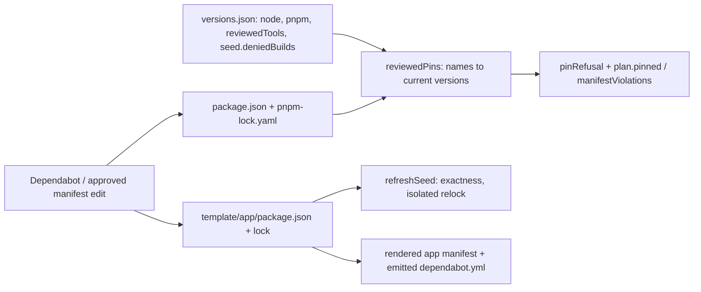

# Fix Dependency Update Authority - Plan

## Goal Capsule

Make supported dependency updates in `nextjs-dev-template` mergeable. A routine Dependabot change to a package manifest and its lock should pass the existing gates without a third edit. Unsupported majors should be held, with a reason recorded for each hold. Today two things block this:

- `tooling/versions.json` duplicates every package version, and contracts fail when a manifest moves.
- Both npm Dependabot groups catch every update type with `patterns: ["*"]`. That bundles five unrelated majors into PRs #2 and #3, including TypeScript 7.

The fix ships as one feature PR. Afterwards, the proposals are refreshed and judged one by one. This plan does not migrate to TypeScript 7, change the runtime, add CI jobs or permissions, or cut a release.

## Product Contract

### Summary

The package manifests become the only authority for package versions. `tooling/versions.json` keeps three things:

- the Node and pnpm runtime metadata;
- a name-only list of the generator's reviewed tools;
- the seed's denied builds.

Dependabot's configuration changes in three places: the two root npm entries and the emitted app config. Coupled packages are grouped into families, routine minor and patch updates share one group, and only the proven-unsupported major lines are held. All existing dependency policy stays in place.

### Problem Frame

- `tests/contracts/toolchain.test.ts:35` requires the root manifest to match `versions.root.devDependencies`. `tests/contracts/rendered-output.test.ts:322` requires the seed manifest to equal `versions.seed`. `scripts/template/seed.cjs:21` refuses a seed relock on any drift. Dependabot edits only manifests and locks, so every bot PR that touches a pinned name fails, even when the update is compatible.
- `.github/dependabot.yml` has the groups `tooling` and `application-seed`. `template/app/.github/dependabot.yml` has the group `dependencies`. All three use `patterns: ["*"]` with no update-type split.
- PRs #2 and #3 both propose five majors: `typescript` 7.0.2, `eslint` 10.12.0, `@eslint/js` 10.0.1, `@types/node` 26.6.5 and `globals` 17.13.0. None of these is a patch or minor update. Each needs its own decision.
- Earlier plans under `.compound-engineering/artifacts/plans/` are historical and stay unedited. This plan does not reopen their scope.

### Requirements

- R1. A root-only manifest and lock update inside the supported lines passes the existing gates without editing `tooling/versions.json` or the seed.
- R2. A seed-only manifest and lock update inside the supported lines passes the existing gates without a generator version edit. This includes rendering, installing, checking and building the generated app.
- R3. In the generator, `deps:add`, `deps:remove` and `deps:upgrade` still refuse a named reviewed tool before pnpm runs. A no-name upgrade stays all-or-nothing, and a collateral change to a reviewed tool is still rolled back. Adding an ordinary dependency still works.
- R4. Malformed reviewed-tool data gives the maintainer a clear refusal before pnpm runs. It never silently removes a tool from protection. Malformed means a non-list or duplicate entry, a name missing from the root manifest, or a non-exact manifest version.
- R5. `template:seed:refresh` uses the seed manifest as its authority, refuses non-exact seed versions, and on failure leaves the existing seed lock as it was.
- R6. Dependabot opens coupled families together and routine minor and patch updates in one group per directory. Each held major line carries a reason and a removal condition in the root config and the emitted app config. Other majors arrive as individual PRs.
- R7. Generated apps still have no `versions.json` and no generator pin restriction. Their Dependabot config equals the seed config.
- R8. Exact pins, reviewed overrides, build denials, the release-age limit, strict peers, `pnpm run audit:dependencies`, the guard and the CI jobs all stay as they are. No auto-writing workflow and no new token permission are added.
- R9. PRs #2 and #3 are not merged unchanged. Each one gets a recorded disposition against `main` after the fix lands.

### Scope

In scope:

- Reducing `tooling/versions.json`.
- Reviewed-pin resolution in `scripts/dependencies.cjs`.
- The seed refresh precondition in `scripts/template/seed.cjs`.
- The contracts and tests that read the removed maps.
- The three npm Dependabot entries and their contract.
- Toolchain and CI documentation.
- Refreshing the proposals and recording their dispositions after merge.

Out of scope:

- TypeScript 7 adoption, including the dual-compiler alias setup.
- A Node 26 runtime.
- Converting to a workspace or forcing root and seed versions to match.
- A sync command or bot writer.
- New CI jobs or platforms.
- Changes to security-update grouping.
- A release bump or tag.

## Planning Contract

### Key Technical Decisions

- KTD1. **Manifests own package versions.** Root versions come from `package.json` and seed versions from `template/app/package.json`. The root and seed graphs stay independent, so no contract requires their versions to be equal. Rejected alternative: a sync command. Dependabot edits only native manifests ([options reference](https://docs.github.com/en/code-security/reference/supply-chain-security/dependabot-options-reference)), so every bot PR would still need a follow-up protected edit.
- KTD2. **`versions.json` keeps `node`, `pnpm`, `root.reviewedTools` and `seed.deniedBuilds`.** `root.reviewedTools` lists the 18 current `root.devDependencies` names explicitly. It is not derived from the manifest, because deriving it would turn future ordinary additions into reviewed tools. The file name is historical, and the docs will describe what it now contains.
- KTD3. **The pinned snapshot is taken before the transaction.**
  - `reviewedPins` resolves the names in `reviewedTools` to their current root manifest versions before `host.transact`. The current call order at `scripts/dependencies.cjs:195` already does this.
  - The `plan.pinned` map that `scripts/core/dependency-policy.cjs:manifestViolations` checks, and its `Record<string,string>` shape, stay unchanged.
  - The app role still returns `{}` without reading generator metadata, and a missing file keeps its current behavior.
- KTD4. **Malformed reviewed-name data is refused through the existing refusal path.** `main` already prints refusals and exits 1 before pnpm (`scripts/dependencies.cjs:190-200`). Malformed `reviewedTools` data produces actionable messages through that same path. This adds no new exception type, guard behavior or recovery mechanism.
- KTD5. **The seed refresh checks exactness instead of equality.** `refreshSeed` keeps the disposable copy, the isolated lock-only resolve, the success-only write and the cleanup. Only the equality gate is replaced: it now checks that every seed `dependencies` and `devDependencies` entry is an exact version, using the existing `isExactVersion` (`scripts/core/dependency-policy.cjs:170`).
- KTD6. **Dependabot groups families first, then a minor/patch catch-all.**
  - Groups are matched in order, the first match wins, and an unmatched update gets its own PR ([options reference](https://docs.github.com/en/code-security/reference/supply-chain-security/dependabot-options-reference)).
  - Families allow every update type, so a coupled major stays in one PR:
    - root: `vitest` + `@vitest/coverage-v8`, `eslint` + `@eslint/js`, `@commitlint/cli` + `@commitlint/config-conventional`;
    - seed and app: the same three, plus `next` + `eslint-config-next`, and `react` + `react-dom` + `@types/react` + `@types/react-dom`.
  - The existing catch-all groups keep their names and get `update-types: [minor, patch]`. No rule blocks all majors.
- KTD7. **Holds are limited to support boundaries backed by evidence.**
  - **`typescript` `>=7`, in all three npm entries.** `typescript-eslint` 8.71.2 and `@typescript-eslint/typescript-estree` declare a TypeScript peer of `<6.1.0` ([metadata](https://registry.npmjs.org/typescript-eslint/8.71.2), [support matrix](https://typescript-eslint.io/users/dependency-versions/)). Also, `tooling/eslint/suppression-policy.mjs` imports the compiler API, which TS 7.0 does not provide ([TS 7 announcement](https://devblogs.microsoft.com/typescript/announcing-typescript-7-0/)). Remove the hold when a `typescript-eslint` release supports TS 7 and the suppression policy has a supported API.
  - **`@types/node` `>=25`, in all three npm entries.** The runtime is Node 24 (`.node-version`, `engines.node`). Remove the hold together with a deliberate runtime-major upgrade.
  - **`eslint` and `@eslint/js` `>=10`, only in the seed entry and the app config.** `eslint-config-next` 16.4.2 depends on `eslint-plugin-react` `^7.37.0`, `eslint-plugin-import` `^2.32.0` and `eslint-plugin-jsx-a11y` `^6.10.0`. Their latest releases declare ESLint peers of `^9.7`, `^9` and `^9` ([react](https://registry.npmjs.org/eslint-plugin-react/latest), [import](https://registry.npmjs.org/eslint-plugin-import/latest), [jsx-a11y](https://registry.npmjs.org/eslint-plugin-jsx-a11y/latest), [config](https://registry.npmjs.org/eslint-config-next/16.4.2)). Remove the hold when those peers accept ESLint 10.
  - **No ESLint hold at the root.** The root lint config imports only `@eslint/js`, `eslint/config`, `typescript-eslint` and `tooling/eslint/shared.mjs`, and `typescript-eslint` 8.71.2 accepts ESLint `^10.0.0`. A root ESLint 10 PR comes through the `eslint` family and is judged on its diff and CI. Existing CI already lints the generator and a rendered app. That matters because the shared `tooling/eslint/*.mjs` files are copied into the app and must keep working under ESLint 9 there.
  - **The registry metadata is re-checked when U3 is implemented.** If a peer range has changed by then, follow the new evidence instead of this plan's snapshot.
- KTD8. **`globals` 17 has no hold.** It arrives as an individual major PR, assessed in U4 against the environment names used in `tooling/eslint/shared.mjs` and the rendered app's lint run. `eslint-config-next` keeps its own `globals` 16.4.0, so a second copy in the seed lock is expected.
- KTD9. **The security impact of holds is documented, not engineered around.** A version ignore also removes security-update candidates from the held line ([controlling dependencies](https://docs.github.com/en/code-security/how-tos/secure-your-supply-chain/manage-your-dependency-security/controlling-dependencies-updated)). `pnpm run audit:dependencies` and `tooling/audit-policy.json` remain the security gate. The YAML comments and `docs/contributing/ci.md` state one re-evaluation condition: if an advisory's only fix lies inside a held line, reassess that hold. No new mechanism is added.

### Assumptions

- A1. **Staying on TypeScript 6 is this plan's decision, not something the user approved.** The user asked to make updates possible. They did not ask for TS 7. TS 7 is possible today through the dual-compiler aliases (`typescript` → `@typescript/typescript6`, plus a native alias). That is a separate migration covering compiler/API ownership, `tsc` resolution in `scripts/development.cjs` and in Next's CLI resolver, checked JavaScript, and generated projects. This plan does not deliver it.
- A2. "Compatible update" means an update inside the held boundaries that passes the existing gates. No candidate is assumed compatible before its diff and CI are reviewed.
- A3. Every push, PR, merge, PR close and Dependabot comment is a separate publishing action that needs the user's approval each time.
- A4. Dependabot reads its config from `main`. When a refreshed run happens is not guaranteed.

### Sequencing

U1 → U2 → U3 on one feature branch, shipped as one PR. U4 starts only after the user approves the merge and the PR reaches `main`.

### High-Level Technical Design

This sketch shows the authority boundaries; implementation details follow the existing functions.

## Implementation Units

### U1. Reviewed tool names resolved from the root manifest

- **Goal:** Remove the duplicated root versions while keeping the reviewed-tool protection.
- **Requirements:** R1, R3, R4, R7, R8.
- **Dependencies:** none.
- **Files:** `tooling/versions.json`, `scripts/dependencies.cjs`, `tests/support/json.ts`, `tests/unit/dependencies.test.ts`, `tests/integration/dependencies.test.ts`, `tests/integration/dependencies-cli.test.ts`, `tests/unit/dependency-policy.test.ts`.
- **Approach:**
  - **`versions.json`.** Replace `root.devDependencies` with `root.reviewedTools`, listing all 18 current names, and drop `seed.dependencies` and `seed.devDependencies`.
  - **`rootPins`.** It takes the parsed metadata and the root manifest, and returns either the resolved name→version map or the list of malformed-data messages.
  - **`main`.** Malformed messages are added to the existing refusal output before pnpm runs.
  - **`pinRefusal` text.** The message currently sends maintainers to `tooling/versions.json` first. It changes to: edit the manifest through the approved route, then relock.
  - **Types.** `Versions` in `tests/support/json.ts` gets `root.reviewedTools: string[]` and loses the dependency maps.
  - **Protected-file route.** `tooling/` and `scripts/` are protected, so these edits use the approved route in `AGENTS.md`. No relock is needed because the manifests do not change.
- **Scenarios:**
  1. A generator whose manifest moves a reviewed tool to a new exact version: the resolved pins report the manifest version, with no `versions.json` edit.
  2. `deps:add` of a new ordinary package succeeds, and the next command does not treat it as reviewed.
  3. A named add, remove or upgrade of a reviewed tool, and a no-name upgrade, are refused before the runner is called (existing evidence at `tests/integration/dependencies.test.ts:768,892` and `tests/integration/dependencies-cli.test.ts:58`).
  4. An ordinary upgrade that indirectly changes a reviewed tool is rejected and rolled back. The snapshot comes from the state before the mutation.
  5. `reviewedTools` that is not a list, has a duplicate, names a package missing from the manifest, or names a range version: each case exits 1 with a message naming the entry, and pnpm never runs.
  6. In the app role, the result is `{}` even when a stray metadata file is present.
- **Verification:** the focused unit and integration scenarios listed in the Verification Contract.

### U2. Seed refresh, contracts and docs under manifest authority

- **Goal:** The seed and the rendered contracts use the seed manifest as their authority without losing exactness or isolation checks.
- **Requirements:** R2, R5, R7, R8.
- **Dependencies:** U1, which sets the new `Versions` shape.
- **Files:**
  - Code: `scripts/template/seed.cjs`.
  - Tests: `tests/contracts/toolchain.test.ts`, `tests/contracts/rendered-output.test.ts`, `tests/integration/toolchain.test.ts`, `tests/integration/template-commands.test.ts`.
  - Docs: `docs/contributing/toolchain.md`.
- **Approach:**
  - **`refreshSeed`.** Replace the `same(...)` gate with the exactness check from KTD5. The refusal names the non-exact entries.
  - **Toolchain contract.** Keep the Node and pnpm cross-file checks, the denied builds, the workspace policy and `devEngines` absent. Replace the pin projection with two checks: every reviewed name is present with an exact version in the root manifest, and every entry in both manifests is exact.
  - **Rendered-output contract.** Compare emitted dependencies and lock importers with `template/app/package.json`. It still proves that `versions.json` is not emitted.
  - **Integration fixture.** `tests/integration/toolchain.test.ts:132` builds its seed fixture from the seed manifest. Node still comes from the metadata.
  - **Toolchain doc.** The numeric dependency rows point at each manifest. "Why these versions" describes the held lines and their removal conditions. "Reviewed pins versus ordinary dependencies" explains that tool names live in metadata and versions live in the manifest. Package numbers that would drift on every update are removed.
- **Scenarios:**
  1. Seed refresh with a changed but exact seed manifest: the isolated resolve writes only the seed lock, and the root graph is untouched.
  2. Seed refresh with a range version is refused before resolving, and the lock bytes are unchanged.
  3. Seed refresh whose resolve fails keeps the original lock and removes the scratch directory.
  4. A seed-only version change keeps the rendered-output and toolchain contracts green without a metadata edit.
  5. A root-only version change keeps the root contract green, and the seed is untouched.
- **Verification:** contracts through `check`. Integration scenarios `template-commands` and `toolchain`. CI's rendered-app gates cover installing, building and checking the generated app.

### U3. Dependabot families, routine group and evidence-based holds

- **Goal:** Each bot PR covers one reviewable kind of change, in both the generator and generated apps.
- **Requirements:** R6, R7, R8.
- **Dependencies:** U1 and U2 must land in the same PR, so that the new groups produce mergeable PRs.
- **Files:** `.github/dependabot.yml`, `template/app/.github/dependabot.yml` (protected under `template/app/`), `tests/contracts/workflows.test.ts`, `docs/contributing/ci.md`, `template/app/docs/contributing/ci.md`.
- **Approach:**
  - **Groups and holds.** Apply KTD6 and KTD7 to the root `/` entry, the root `/template/app` entry and the app's `/` entry. Each `ignore` entry gets a one-line YAML comment with its reason and removal condition, plus the security re-evaluation note from KTD9.
  - **Unchanged settings.** The schedule, PR limit, Actions group and directories stay as they are, and nothing auto-merges.
  - **Re-check peers.** Re-verify the ESLint plugin peer metadata before writing the seed hold.
  - **Contract test.** Replace the `groups:` count at `tests/contracts/workflows.test.ts:360` with semantic assertions. Do not snapshot the full YAML.
  - **Docs.** Both `ci.md` files describe families, the routine group and the holds.
- **Scenarios:**
  1. In every npm entry, each family group comes before the catch-all, and the catch-all limits update types to `minor` and `patch`.
  2. A `typescript` `>=7` hold and an `@types/node` `>=25` hold appear in all three npm entries. An ESLint and `@eslint/js` `>=10` hold appears only in the seed and app entries.
  3. No ignore covers every major (`version-update:semver-major` without a dependency name).
  4. The emitted `.github/dependabot.yml` still equals the seed config and contains no `/template/app` (existing `workflows.test.ts:65-72`).
  5. Nothing in the config auto-merges, and no workflow gains `pull_request_target` or write permissions.
- **Verification:** the `workflows` and `rendered-output` contracts through `check`, and `docs:build`.

### U4. Post-merge proposal refresh and dispositions

- **Goal:** Reassess the old proposals against the merged fix and record which can proceed.
- **Requirements:** R1, R2, R9.
- **Dependencies:** the U1–U3 PR is merged to `main` with the user's approval.
- **Files:** none in the repository. Where needed, the manifest and lock of a separate update PR: `package.json`/`pnpm-lock.yaml` or `template/app/package.json`/`template/app/pnpm-lock.yaml`.
- **Approach:**
  - **Refresh.** Inspect the proposals available after merge and request a recreate with the user’s approval when needed. The scope of the existing group names changed, so prefer new proposals and do not rely on a rebase ([comment commands](https://docs.github.com/en/code-security/reference/supply-chain-security/dependabot-pull-request-comment-commands)). Recreating discards manual edits, so it comes before any hand change.
  - **Review.** For each refreshed PR, review the actual dependency diff and the CI result. Green CI alone does not justify a held line.
  - **Assessments.**
    - The root ESLint 10 family PR and the `globals` 17 PR are each judged on their diff and on the shared lint code under both graphs.
    - A failure caused by peers or release age is classified. It is not bypassed.
  - **No suitable replacement.** Record the current proposal’s blocker and leave it open where it is not superseded. Do not manufacture another dependency update or wait for a scheduled run to prove this fix; U1–U3 regression coverage and existing CI establish R1 and R2. Subsequent version changes remain separately reviewed work.
  - **Old PRs.** Close #2 and #3, with the user's approval, only once a replacement exists or a documented hold covers each of their packages. Link the replacement PRs or name the hold in each closing comment. Closing uses ordinary GitHub controls, since the Dependabot close and merge commands were retired ([changelog](https://github.blog/changelog/2026-01-27-changes-to-github-dependabot-pull-request-comment-commands/)).
- **Scenarios:**
  1. Any available root replacement is judged against its actual manifest/lock diff and CI.
  2. Any available seed replacement is judged against its diff and CI, including the rendered-app gates.
  3. If refreshed proposals are available, they respect the holds: no TypeScript 7 or `@types/node` 25 or later, and no seed/app ESLint 10. Stale proposals are not treated as evidence that the new config ran.
  4. The disposition of #2 and #3 is recorded with replacement links, applicable holds or an explicit reason to keep the PR open.
- **Verification:** the CI results of the refreshed PRs and a review of their diffs. No release bump or tag follows automatically.

## Verification Contract

Canonical gates:

- `pnpm run check` and `pnpm run docs:build`. The pre-push hook runs both, so do not repeat a gate that already passed.
- Focused feedback while developing: `pnpm run test:one --test=<path>` on the unit and contract files touched in U1–U3.
- `pnpm run test:integration --scenario=dependencies`, `--scenario=dependencies-cli`, `--scenario=template-commands` and `--scenario=toolchain`. Run only the scenario you are changing.
- `pnpm run template:seed:refresh` exercises the seed path. For an approved reviewed-tool manifest edit in U4, relock with `node scripts/bootstrap.cjs deps-lock`. For an ordinary dependency, use `pnpm run deps:upgrade --package=<name>`.
- `pnpm run audit:dependencies` shows that the reviewed advisory decisions still hold.
- CI on the PR runs the full integration matrix plus `test:e2e` and `test:artifact`. Those results are authoritative.

Stop and report a concrete blocker if success would require any of the following:

- suppressing lint or type failures;
- weakening exact pins, overrides, build denials, peers or release age;
- relaxing the guard or the transaction;
- a TS 7 or runtime-major migration nobody has approved.

## Definition of Done

- `tooling/versions.json` contains only `node`, `pnpm`, `root.reviewedTools` and `seed.deniedBuilds`. No contract, test or script reads package versions from it.
- U1 scenarios 1–6 and U2 scenarios 1–5 are covered by passing tests. Reviewed-tool refusal, all-or-nothing upgrade and collateral-change rollback still have regression evidence.
- All three npm Dependabot entries have the family groups, the minor/patch catch-all and the KTD7 holds, each with its reason and removal condition. The workflow contract checks these semantics.
- The docs describe manifest authority, the held lines and the security re-evaluation condition. No TS 7 migration is claimed.
- The fix ships as one PR that passes the hook gates and CI, with no new job, permission or bot writer.
- After merge, PRs #2 and #3 have recorded dispositions. Only superseded or fully held proposals are closed; unresolved ones retain their concrete blocker. Additional update PRs are not a completion gate for this fix. No release was bumped or tagged as part of this work.
