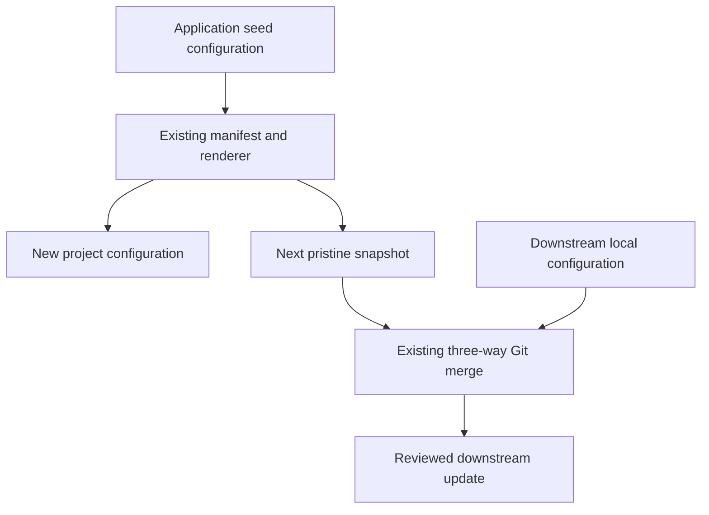

# Codex Plugin Defaults - Plan

## Goal Capsule

- **Objective:** Template maintainers and downstream developers start Codex sessions with remote catalog plugins disabled and unspecified plugins disabled by default.
- **Means:** Complete the existing configuration and distribute it through normal rendering and template updates (KTD1–KTD2).
- **Authority:** The user request and repository rules govern this plan; requirements govern behavior, technical decisions govern implementation.
- **Execution:** Implement and verify on a feature branch. Codex prepares the exact protected-file diff for the user to apply; it does not write protected files directly.
- **Stop conditions:** Unexpected protected-state drift, unsupported Codex settings, or a required update-engine change need investigation before proceeding.
- **Delivery:** Complete local verification and a Conventional Commit with GitHub noreply metadata. Publishing, PR creation, releases, and downstream application remain separate user decisions.

## Product Contract

### Summary

Add the missing plugin default to the generator and application seed, preserve the existing remote catalog setting and Compound Engineering opt-in, and prove delivery to new and upgraded projects.

### Problem Frame

Both configuration copies already contain `features.remote_plugin = false` and explicitly enable Compound Engineering, but neither contains `plugins._default.enabled = false`.
Older downstream projects may lack one or both defaults.
The manifest already includes the emitted Codex configuration, so changing only the generator's settings would leave generated projects incomplete.

### Requirements

**Configuration**

- R1. The generator and emitted application configure `features.remote_plugin = false` and `plugins._default.enabled = false`.
- R2. Preserve the explicit `compound-engineering@compound-engineering-plugin` enablement, marketplace declaration, and existing approval and hook settings.

**Distribution**

- R3. Freshly rendered projects receive R1–R2 through the existing template manifest.
- R4. Downstream projects with valid template lineage receive these settings when updating to a published revision containing the change, subject to the existing three-way merge and user conflict resolution.
- R5. The completed, human-reviewed update preserves unrelated local configuration and explicit plugin choices and contains each intended TOML table once.

### Scope Boundaries

No global Codex configuration edits, plugin uninstallation, forced replacement of downstream files, or live downstream updates.
Do not add a TOML merge engine or migration command: use the existing review boundary for textual conflicts and configuration validity.
Independent skills and explicitly enabled plugins are outside the default-disable guarantee.

## Planning Contract

### Key Technical Decisions

- KTD1. **Keep both declarations identical.** Add the default-disable table to `.codex/config.toml` and `template/app/.codex/config.toml`; preserve R2. Existing `tests/contracts/agent-staging.test.ts` checks byte parity.
- KTD2. **Reuse manifest-driven updates.** `tooling/template-manifest.json` copies the seed configuration to `.codex/config.toml`. `scripts/template/preview.cjs` and `scripts/template/update.cjs` render and merge the next pristine snapshot. No manifest, updater, or state-schema change is needed. A clean textual merge does not prove valid TOML: identical tables inserted at different positions must be reconciled during the existing human review before acceptance and commit (R5).
- KTD3. **Test actual distribution boundaries.** Extend existing contract and rendering tests, then add a real-Git upgrade regression using `tests/support/template-lineage.ts`. Keep that proof in the integration suite.
- KTD4. **Separate file evidence from host behavior.** Automated tests prove declarations and propagation. A fresh trusted-project Codex session must confirm effective plugin loading before claiming runtime success; an existing session's skill list is not that proof.

### High-Level Technical Design

### Constraints and Evidence

`AGENTS.md` reserves protected-file edits for approved routes and downstream apply for the user.
Prepare the two-file configuration diff as a reviewable private artifact during implementation, then request user application.
Before touching the seed, follow the repository's installed Next.js documentation prerequisite; this work changes no Next.js APIs.

The [OpenAI configuration reference](https://learn.chatgpt.com/docs/config-file/config-reference) documents the remote catalog flag.
That page did not establish the `plugins._default` key during planning; its installed-client interpretation remains an implementation smoke check under KTD4.
The requested syntax is the observed configuration in the user's reference project, not proof of runtime behavior.

## Implementation Units

### U1. Complete configuration and prove new-project output

**Goal:** Deliver R1–R3 without changing approval or hook behavior.
**Dependencies:** None.
**Files:** `.codex/config.toml`, `template/app/.codex/config.toml`, `tests/contracts/agent-permissions.test.ts`, `tests/contracts/rendered-output.test.ts`; verify existing `tests/contracts/agent-staging.test.ts`.
**Approach:** Extend the existing plugin assertions to cover the default and explicit opt-in in both copies. Prepare the protected diff for user application. Check actual renderer output, following KTD1–KTD3.
**Test scenarios:**

1. Both declarations retain the remote catalog opt-out and Compound Engineering opt-in while including the default-disable table exactly once.
2. Rendering with distinct project names and owners emits the complete same Codex configuration.
3. Existing root/seed parity and approval/hook checks continue to pass.

**Verification:** Focused contract and rendered-output tests pass; KTD4's fresh-session check confirms effective settings.

### U2. Prove upgrades and document the policy

**Goal:** Deliver R4–R5 and explain how existing projects receive the change.
**Dependencies:** U1.
**Files:** `tests/integration/template-update.test.ts`, `docs/contributing/agents.md`, `docs/updating.md`.
**Approach:** Use the existing lineage fixture to create older source baselines, then advance the seed to the complete configuration. Exercise preview/apply in disposable fixtures only. Document project defaults, the explicit opt-in exception, and updating to a published ref through the existing human-owned workflow. Include KTD2's duplicate-table review even when the preview reports a clean merge.
**Test scenarios:**

1. A baseline missing both defaults updates to the complete configuration while preserving an unrelated, nonoverlapping local setting.
2. A baseline already containing the remote catalog opt-out receives the missing plugin default.
3. A downstream project that already added the same default at the template's position merges without duplicate tables; after finishing the update, another preview of that ref is current.
4. Identical defaults inserted at different positions can produce duplicate tables despite a clean Git result. The configuration contract rejects the duplicate; the fixture models human reconciliation before acceptance and commit, then verifies a single table and a current subsequent preview.
5. Incompatible local edits in the same configuration region surface as a normal content conflict, preserving both sides for user resolution.

**Verification:** The `template-update` integration scenario passes, and documentation describes actual merge behavior without promising unconditional overwrite.

## Verification Contract

During implementation, use `pnpm run test:one --test=<path>` for the three contract files named in U1.
Use `pnpm run test:integration --scenario=template-update` while developing U2's integration regression; do not run the full integration matrix locally.
Existing hooks own routine verification: pre-commit checks changed files; pre-push runs `pnpm run check` and `pnpm run docs:build` when publishing is approved. Do not duplicate a passing hook gate.

For the host smoke check, record the installed Codex version and inspect effective plugin state in a new trusted-project session: the remote catalog is off, unspecified plugins are disabled, and Compound Engineering remains enabled. If the installed client cannot establish this behavior, report that limitation and investigate before declaring the runtime objective complete.
No tests, release commands, or runtime probes run as part of writing this plan.

## Definition of Done

- U1 and U2 satisfy their cited requirements and verification outcomes.
- Both protected configuration copies match, and rendered and upgraded outputs contain the intended settings.
- Local configuration preservation, identical-setting merge, and conflict handling have integration coverage.
- The fresh-session result is recorded with its client version; unavailable runtime proof is explicitly reported rather than represented as a pass.
- Documentation explains the defaults and human-owned upgrade path.
- The final diff contains no abandoned experiments, new merge machinery, or unrelated configuration changes.
- The feature branch is ready for the user's publication decision; this plan remains unchanged after review.
